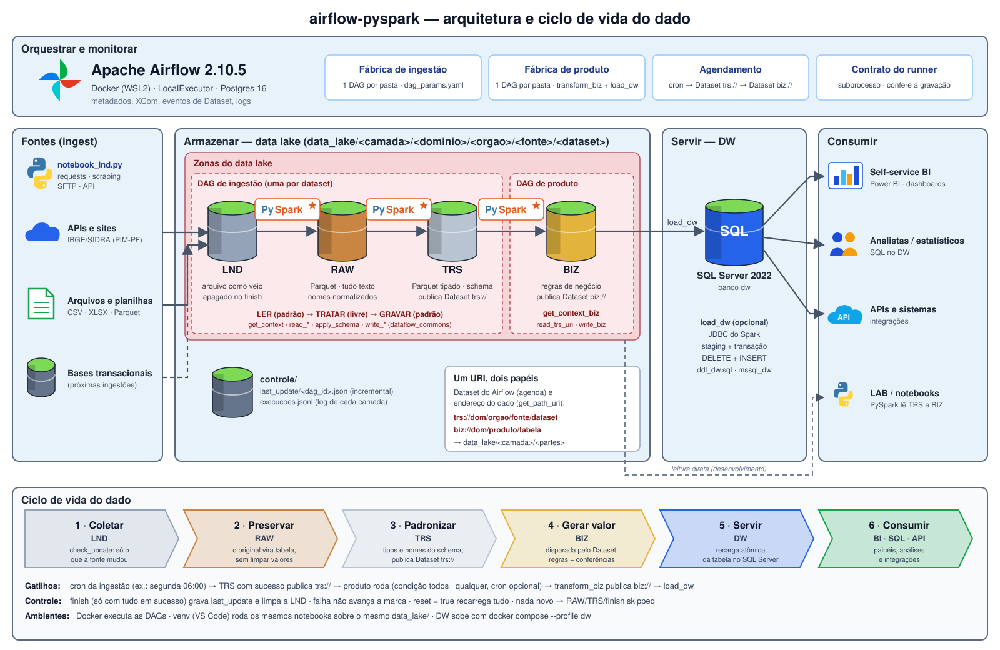
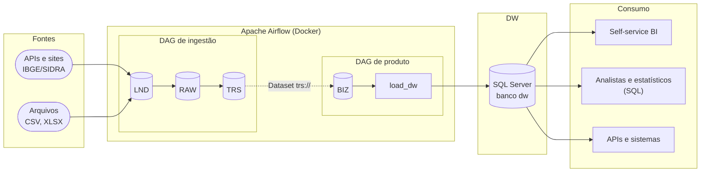
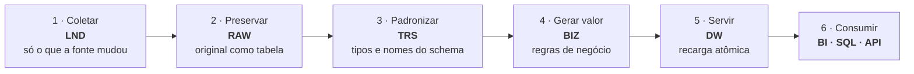
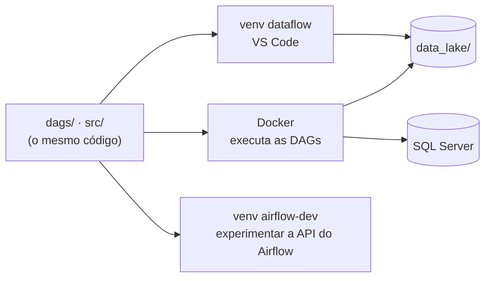
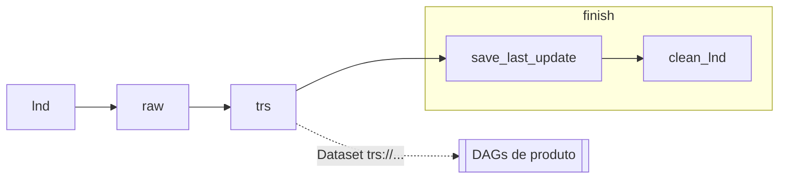
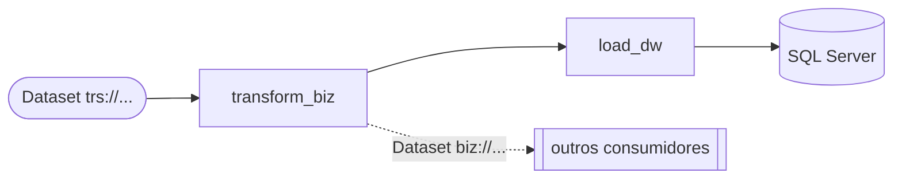
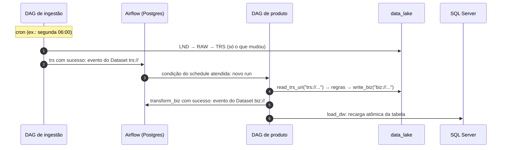

# airflow-pyspark

Ambiente e padrão de arquitetura para pipelines de dados com **Apache Airflow 2.10.5** e **PySpark 3.5.3**
em Docker (WSL2). O dado entra pelas DAGs de **ingestão** (LND → RAW → TRS), vira informação de negócio nas
DAGs de **produto** (BIZ) e é servido no **DW** (SQL Server) para BI, análises e integrações.



> Imagem gerada por [`docs/img/gerar_arquitetura.py`](docs/img/gerar_arquitetura.py) (também em
> [PNG](docs/img/arquitetura.png)). Os demais diagramas são [Mermaid](https://mermaid.js.org/): o GitHub os
> desenha; no VS Code, instale a extensão *Markdown Preview Mermaid Support*.

| Documento | Para quê |
|---|---|
| [`dags/ingestao/README.md`](dags/ingestao/README.md) | Guia completo para criar uma DAG de ingestão: parâmetros, desenhos possíveis, notebooks, incremental |
| [`dags/produto/README.md`](dags/produto/README.md) | Guia completo para criar uma DAG de produto: agendamento por Dataset, notebook da BIZ, carga no DW |
| [`docs/decisoes.md`](docs/decisoes.md) | Decisões de arquitetura e seus motivos |

**Sumário**

1. [Arquitetura](#1-arquitetura)
2. [Ciclo de vida do dado](#2-ciclo-de-vida-do-dado)
3. [Ambiente](#3-ambiente)
4. [Estrutura do repositório](#4-estrutura-do-repositório)
5. [Camadas e nomenclatura](#5-camadas-e-nomenclatura)
6. [DAGs de ingestão](#6-dags-de-ingestão)
7. [DAGs de produto e DW](#7-dags-de-produto-e-dw)
8. [Ligação entre ingestão e produto](#8-ligação-entre-ingestão-e-produto)
9. [Módulo comum: `dataflow_commons`](#9-módulo-comum-dataflow_commons)
10. [Solução de problemas](#10-solução-de-problemas)
11. [Pendências](#11-pendências)

---

## 1. Arquitetura



| Peça | Papel | Onde |
|---|---|---|
| **Airflow 2.10.5** | orquestra, agenda e monitora. A DAG **só orquestra**: não tem regra de dado | `docker-compose.yaml` (scheduler, webserver, Postgres 16) |
| **Fábricas de DAG** | geram uma DAG por pasta a partir do `dag_params.yaml` (ninguém escreve `DAG(...)` à mão) | `dags/ingestao/_dag_factory_ingestao.py`, `dags/produto/_dag_factory_produto.py` |
| **Notebooks** | a lógica de cada fonte e de cada produto: **LER → TRATAR → GRAVAR** (`.py` com células `# %%`) | uma pasta por ingestão ou produto |
| **`dataflow_commons`** | funções padrão: contexto, leitura, gravação, schema, incremental, runner, DW | `src/dataflow_commons/` |
| **PySpark 3.5.3** | processamento (`local[*]`, Java 17), em subprocesso por task | dentro da imagem e no venv |
| **Data lake** | camadas em pastas e Parquet | `data_lake/` (montado em `/opt/airflow/data_lake`) |
| **SQL Server 2022** | DW de desenvolvimento, servido para o consumo | serviço `sqlserver` do compose, profile `dw` |

---

## 2. Ciclo de vida do dado



| Etapa | Camada | O que acontece | Quem faz | Formato e local |
|---|---|---|---|---|
| 1. Coletar | **LND** | baixa da fonte **só os períodos que mudaram** (`check_update`) e grava o arquivo como veio | `notebook_lnd.py` | o da fonte · `lnd/.../<period_id>/` · **apagado no fim** |
| 2. Preservar | **RAW** | transforma o arquivo em tabela, sem limpar valores; nomes de coluna normalizados | `notebook_raw.py` | Parquet, tudo texto · `raw/.../<period_id>/` |
| 3. Padronizar | **TRS** | trata as regras da fonte, aplica o schema (nomes e tipos) e publica o Dataset `trs://` | `notebook_trs.py` | Parquet tipado · `trs/.../<period_id>/` ou partição |
| 4. Gerar valor | **BIZ** | disparada pela TRS: recorte, cálculos, conferências | `notebook_biz.py` | Parquet · `biz/<dominio>/<produto>/<tabela>/` |
| 5. Servir | **DW** | recarrega a tabela no SQL Server, numa transação | task `load_dw` | tabela do banco `dw` |
| 6. Consumir | — | BI, consultas SQL, integrações; LAB lê TRS e BIZ direto | usuários | — |

**Controle** (em `data_lake/controle/`): `last_update/<dag_id>.json` guarda até onde a ingestão já carregou;
`execucoes.jsonl` registra início, fim, falha e atualização de cada camada. A marca só avança quando a DAG
inteira termina com sucesso, então uma falha faz a próxima execução tentar de novo.

**Exemplo real:** a ingestão da PIM-PF (IBGE/SIDRA, tabela 8888) atualiza a TRS; isso dispara o produto
`industria_transformacao`, que calcula, para cada UF e mês de 2025, o índice de cada atividade da Indústria
de Transformação, a média da UF e a diferença; o resultado vai para `dw.dbo.indice_atividade_uf`.

---

## 3. Ambiente

| Componente | Versão / detalhe |
|---|---|
| Windows + WSL2 | Ubuntu 24.04, Python 3.12 |
| Docker | Engine direto no WSL (sem Docker Desktop) |
| Airflow | 2.10.5, `LocalExecutor`, Postgres 16 para metadados |
| PySpark | 3.5.3, `local[*]`, Java 17 |
| DW | SQL Server 2022 Developer (profile `dw`), driver JDBC `mssql-jdbc` na imagem |

O projeto fica em `~/projetos/airflow-pyspark`, dentro do filesystem do Linux (nunca em `/mnt/c`).

### Ambientes que leem o mesmo código



- **Docker**: executa as DAGs; é a referência. Mudança em `dags/` e `src/` vale na hora; em `docker-compose.yaml`,
  `.env` ou `Dockerfile` pede `docker compose up -d` (e `build` no Dockerfile).
- **venv `~/.venvs/dataflow`**: desenvolvimento dos notebooks no VS Code. Não tem Airflow.
  **Grava no mesmo `data_lake/`** que o Docker, inclusive a marca de última atualização.
- **venv `~/.venvs/airflow-dev`** (kernel `airflow-dev`): Airflow instalado só para testar a API em notebook.
  Usa um SQLite vazio: não vê as execuções nem os eventos do Docker.

### Subir

```bash
sudo service docker start                 # se o Docker não estiver ativo
# .env (não versionado): AIRFLOW_UID=$(id -u), usuário/senha do admin, MSSQL_SA_PASSWORD
docker compose up airflow-init            # primeira vez
docker compose --profile dw up -d         # Airflow + SQL Server  (sem --profile dw: só o Airflow)
```

| Serviço | Acesso |
|---|---|
| Airflow | http://localhost:8080 (usuário e senha do `.env`) |
| SQL Server, do Airflow | `sqlserver:1433`, Connection `mssql_dw` (definida no compose) |
| SQL Server, do Windows (SSMS) | `localhost,1433` (ou o IP do WSL, ver [seção 10](#10-solução-de-problemas)), usuário `sa`, senha `MSSQL_SA_PASSWORD`, *Trust server certificate* |

### venv de desenvolvimento

```bash
python3 -m venv ~/.venvs/dataflow
source ~/.venvs/dataflow/bin/activate
pip install -r requirements-dev.txt       # requirements.txt + dataflow_commons editável
```

No VS Code, selecione esse interpretador (*Python: Select Interpreter*). Biblioteca nova: versão fixa em
`requirements.txt` (vale para Docker e venv), depois `docker compose build && docker compose up -d`.

---

## 4. Estrutura do repositório

```
src/dataflow_commons/              módulo comum (pip install -e src/)
dags/
  .airflowignore                   o scheduler não importa notebook_*.py (importar = executar a carga)
  ingestao/
    _dag_factory_ingestao.py       uma DAG por pasta com dag_params.yaml
    README.md                      guia da ingestão
    <dominio>__<orgao_origem>__<fonte_dados>__<dataset>/
      dag_params.yaml  schema_trs.yaml  notebook_lnd.py  notebook_raw.py  notebook_trs.py  README.md
  produto/
    _dag_factory_produto.py        uma DAG por pasta com dag_params.yaml
    README.md                      guia do produto
    <dominio>__<produto>/
      dag_params.yaml  notebook_biz.py  [ddl_dw.sql]  README.md
docker/
  Dockerfile                       imagem do Airflow + Java 17 + driver JDBC do SQL Server
  sqlserver/init.sql               cria o banco dw e o schema biz
docs/
  decisoes.md                      decisões de arquitetura
  img/                             imagem da arquitetura (SVG, PNG e o gerador)
data_lake/                         dados de dev (não versionado)
```

DAGs existentes:

| DAG | Tipo | O que faz |
|---|---|---|
| `producao_fisica_industrial__ibge__sidra__pimpf` | ingestão | PIM-PF do IBGE/SIDRA (tabela 8888), mensal, particionada por `CD_MES_ANO` |
| `producao_fisica_industrial__industria_transformacao` | produto | índice × média da UF por atividade da Indústria de Transformação (2025) → DW |

---

## 5. Camadas e nomenclatura

| Camada | Conteúdo | Caminho |
|---|---|---|
| **LND** | arquivo exatamente como veio da fonte; apagado pelo `finish` | `lnd/<dominio>/<orgao>/<fonte>/<dataset>/<period_id>/` |
| **RAW** | Parquet, colunas como texto e nomes normalizados; colunas técnicas `_NM_ARQUIVO_LND` e `_DH_INGESTAO_RAW` | `raw/.../<dataset>[/<subbase>]/<period_id>/` |
| **TRS** | Parquet tipado pelo `schema_trs.yaml`; `_DH_INGESTAO_TRS`; por período ou partição | `trs/.../<dataset>[/<subbase>]/...` |
| **BIZ** | produto de negócio; lê **somente** da TRS | `biz/<dominio>/<produto>/<tabela>/` |
| **controle** | última atualização e log das execuções | `controle/last_update/`, `controle/.../execucoes.jsonl` |

Regras de nome (validadas ao carregar as DAGs):

- Pastas, `dag_id`, arquivos, sub-bases e `period_id` em `snake_case` minúsculo, sem acento. `__` separa níveis.
- `dag_id` é **gerado**: ingestão = `dominio__orgao_origem__fonte_dados__dataset`; produto = `dominio__produto`.
  A pasta tem exatamente esse nome.
- Colunas sempre em **MAIÚSCULO**, com prefixo na TRS e na BIZ: `CD_ ID_ NM_ DS_ SG_ NR_ QT_ VL_ PC_ DT_ DH_ FL_`.
  Códigos ficam como texto, mesmo numéricos.
- Notebooks: `notebook_<lnd|raw|trs>[_<subbase>].py` e `notebook_biz.py`.
- Commits: Conventional Commits (`feat(ing): ...`, `fix(infra): ...`).

---

## 6. DAGs de ingestão

Uma DAG por dataset de origem. Sem configuração extra, o desenho é:



- **LND** decide o que atualizar: lista o que a fonte tem (com a data que a **fonte** informa), filtra com
  `check_update` (só o que é mais novo que a última carga), baixa e devolve a lista de períodos pelo XCom.
- **RAW** e **TRS** processam um período por vez (`for period_id in ctx.update_list`). Nada novo → *skipped*.
- **finish** só roda com tudo em sucesso: grava a marca e apaga a LND.
- **Recarga completa**: *Trigger DAG w/ config* com `{"reset": true}`.
- Desenhos com sub-bases, grupos e mais tasks são declarados em `params_dag.tasks` do YAML.

Passo a passo, parâmetros, desenhos possíveis e modelos de notebook: **[`dags/ingestao/README.md`](dags/ingestao/README.md)**.

---

## 7. DAGs de produto e DW

Uma DAG por produto, disparada pelas TRS de que depende:



| Task | Obrigatória | Faz |
|---|---|---|
| `transform_biz` | sim | roda o `notebook_biz.py`: lê a TRS, aplica as regras e grava na BIZ (`saida`) |
| `load_dw` | não | recarrega a tabela do DW com a saída: DDL idempotente, staging, `DELETE` + `INSERT` numa transação e conferência da contagem |

O `dag_params.yaml` do produto guarda a entrada (`schedule.datasets`), a saída, o **recorte**
(`tasks.transform_biz.parametros`: ano, códigos, filtros) e a tabela do DW. O notebook lê tudo com
`get_context_biz()`: nada é repetido no código.

```yaml
params_dag:
  dominio: producao_fisica_industrial
  produto: industria_transformacao
  schedule:
    datasets: [trs://producao_fisica_industrial/ibge/sidra/pimpf]
    condicao: todos                   # todos | qualquer; cron opcional
tasks:
  transform_biz:
    saida: biz://producao_fisica_industrial/industria_transformacao/indice_atividade_uf
    parametros: {ano: "2025", cd_variavel_indice: "12606"}
  load_dw:
    tabela: indice_atividade_uf       # [schema.]tabela; conexao: mssql_dw (padrão)
```

Guia completo (agendamento, notebook, DW, conexão): **[`dags/produto/README.md`](dags/produto/README.md)**.

---

## 8. Ligação entre ingestão e produto

As DAGs não se chamam: elas se ligam por **Datasets** do Airflow. O URI do Dataset também é o endereço do dado.

```
trs://<dominio>/<orgao>/<fonte>/<dataset>[/<subbase>]   ->  data_lake/trs/...
biz://<dominio>/<produto>/<tabela>                      ->  data_lake/biz/...
```



- Ingestão sem novidade não publica evento, então o produto não roda à toa.
- O `Dataset` é só um nome: o Airflow não olha o dado. Na UI, o menu **Datasets** mostra quem produz, quem
  consome e o histórico de eventos.

---

## 9. Módulo comum: `dataflow_commons`

| Módulo | Principais funções |
|---|---|
| `context` | `get_context(camada=...)` (ingestão) e `get_context_biz()` (produto): carregam o YAML, a lista de períodos e ligam o logging |
| `readers` | `read_lnd_csv`, `read_lnd_parquet`, `read_lnd_excel`, `df_from_pandas`, `read_raw`, `read_trs`, `read_trs_uri`, `union_by_name` |
| `writers` | `write_lnd`, `write_raw`, `write_trs`, `write_biz` (só gravam; `partition_by`, `mode`, `options` do Spark) |
| `schema` | `apply_schema(df, ctx.schema)`: renomeia e converte; valor que não converte vira NULL |
| `state` | `check_update`, `push_update_list`, `get/save/delete_last_update` (incremental) |
| `runner` | executa cada notebook em subprocesso, repassa o log e **valida o contrato** (gravou nesta execução?) |
| `dw` | carga no SQL Server pelo JDBC do Spark (Connection, DDL, staging, transação) |
| `paths` | caminhos das camadas e `get_path_uri("trs://..." / "biz://...")` |
| `config`, `config_produto` | leitura e validação dos `dag_params.yaml` |
| `lnd`, `spark`, `texto`, `control` | download com retentativas, sessão Spark, normalização de nomes, log de execuções |

Mudou algo aqui? O impacto é em todas as DAGs: confira `airflow dags list-import-errors` e rode uma ingestão
e um produto ponta a ponta (`airflow dags test <dag_id> <data>`).

---

## 10. Solução de problemas

| Sintoma | Causa e solução |
|---|---|
| DAG não aparece | Pasta com nome diferente do `dag_id`, erro no YAML ou arquivo faltando: `airflow dags list-import-errors` e `docker compose logs --tail=100 airflow-scheduler \| grep -A12 "Falha ao criar DAG"` |
| Import error em `notebook_*.py` | O notebook está fora do padrão de nome e não casa com `dags/.airflowignore` |
| RAW, TRS e finish *skipped* | A LND não achou nada novo. Para recarregar: trigger com `{"reset": true}` |
| Produto não roda | DAG pausada; URI do `schedule.datasets` diferente do publicado; ingestão sem novidade |
| `FileNotFoundError /opt/airflow/data_lake/...` | A pasta `data_lake` foi recriada com o container no ar: `docker compose up -d --force-recreate` |
| `PermissionError` em logs ou dados | `docker compose down`; `sudo chown -R $(id -u):0 logs dags plugins config data_lake src tests`; `chmod -R 775`; `up -d` |
| `load_dw`: `Connection refused` | SQL Server fora do ar: `docker compose --profile dw up -d` |
| SSMS não conecta em `localhost,1433` | O repasse de porta do WSL (modo NAT) pode travar. Use o IP do WSL (`wsl hostname -I` no PowerShell) ou ative `networkingMode=mirrored` no `.wslconfig` |
| `logging` não aparece no log da task | Chame `get_context()` / `get_context_biz()` antes de logar |
| `externally-managed-environment` | Use o venv; não use `--break-system-packages` |
| Arquivos `*Zone.Identifier` | Vêm da cópia pelo Windows: `find . -name '*Zone.Identifier' -delete` |

---

## 11. Pendências

| Tema | Situação |
|---|---|
| Qualidade na TRS | não há rejeição de registros: cada notebook confere o que importa; decidir se volta uma etapa de qualidade (fora do `write_trs`) |
| Períodos no produto | o produto recalcula o recorte inteiro; previsto: TRS publica `period_ids` no evento do Dataset |
| DW | carga incremental, usuário de carga no lugar do `sa`, DW de produção (só trocar a Connection) |
| Incremental | marca em arquivo; falta o `PostgresUpdateStore` |
| Sub-bases | assumida uma TRS por sub-base; confirmar |
| Operação | CI (lint e integridade das DAGs), `.env.example`, homologação e produção, alertas |

Detalhes e motivos: [`docs/decisoes.md`](docs/decisoes.md).
