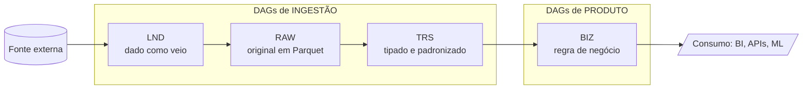
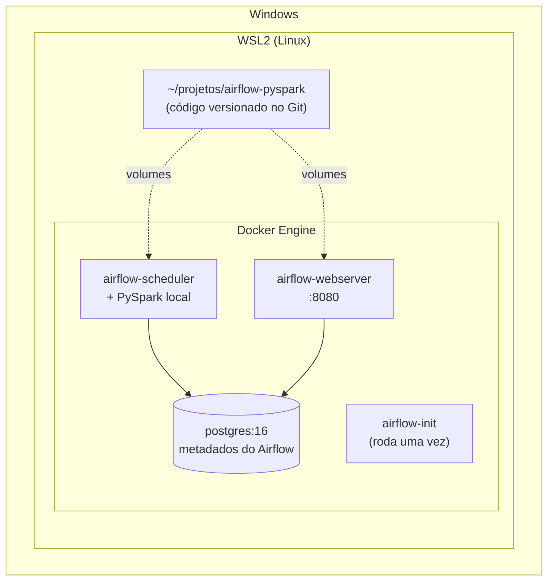

# Airflow + PySpark com Docker

Ambiente de desenvolvimento e padrão de arquitetura para pipelines de dados orquestrados com **Apache Airflow** e processados com **PySpark**, organizados em dois tipos de DAG: **ingestão** (LND → RAW → TRS) e **produto** (BIZ).

## Sumário

1. [Status do projeto](#1-status-do-projeto)
2. [Visão geral](#2-visão-geral)
3. [Ambiente Docker e Airflow](#3-ambiente-docker-e-airflow)
4. [Arquitetura de dados e de DAGs](#4-arquitetura-de-dados-e-de-dags)
5. [Estrutura do repositório](#5-estrutura-do-repositório)
6. [Anatomia de uma DAG](#6-anatomia-de-uma-dag)
7. [Nomenclatura padrão](#7-nomenclatura-padrão)
8. [Boas práticas obrigatórias](#8-boas-práticas-obrigatórias)
9. [Como criar uma nova ingestão ou produto](#9-como-criar-uma-nova-ingestão-ou-produto)
10. [Testes](#10-testes)
11. [Git e entrega](#11-git-e-entrega)
12. [Solução de problemas](#12-solução-de-problemas)
13. [Catálogo de ingestões e produtos](#13-catálogo-de-ingestões-e-produtos)

---

## 1. Status do projeto

| Item | Situação |
|---|---|
| Ambiente Docker (Airflow + Postgres + PySpark local) | Implementado |
| DAG modelo de ingestão (LND → RAW → TRS) | Implementado (`dags/modelo_pipeline/`) |
| DAGs de produto (BIZ) | Planejado |
| Dependência ingestão → produto via Datasets | Planejado |
| CI (testes + lint) | Planejado |

---

## 2. Visão geral



- **Ingestão** traz o dado da fonte e o deixa confiável. Uma DAG por dataset de origem.
- **Produto** consome datasets da TRS e entrega um resultado de negócio. Um produto pode ser composto por **várias DAGs**.
- As duas famílias são independentes: a ingestão não conhece os produtos, e o produto só conhece a TRS.

---

## 3. Ambiente Docker e Airflow

### 3.1 Camadas do ambiente



O projeto deve ficar no sistema de arquivos do Linux (`~/projetos/...`), **não** em `/mnt/c/...`. Isso evita lentidão e problemas de permissão.

### 3.2 Versões

| Componente | Versão |
|---|---|
| Apache Airflow | 2.10.5 (Python 3.12) |
| Executor | `LocalExecutor` |
| Banco de metadados | PostgreSQL 16 |
| PySpark | 3.5.3 (modo `local[*]`) |
| Java | OpenJDK 17 (headless) |

### 3.3 Serviços

| Serviço | Função |
|---|---|
| `postgres` | Guarda o **estado do Airflow** (DAGs registradas, execuções, usuários). Não guarda dados de negócio. |
| `airflow-init` | Roda uma vez: migra o banco, cria o usuário admin e ajusta permissões das pastas. Termina sozinho (é esperado). |
| `airflow-scheduler` | Lê a pasta `dags/` a cada ~30 s, registra as DAGs no Postgres e **executa** as tasks (LocalExecutor). |
| `airflow-webserver` | Interface web. Só lê o Postgres e mostra o estado; não executa nada. |

Fluxo: o arquivo da DAG é lido pelo scheduler → registrado no Postgres → exibido pelo webserver → disparado → executado pelo scheduler.

### 3.4 Arquivos do ambiente

| Arquivo | Função |
|---|---|
| `docker/Dockerfile` | Imagem do Airflow acrescida de Java e PySpark |
| `docker-compose.yaml` | Define serviços, rede, volumes e variáveis |
| `.env` | UID do usuário e credenciais do admin. **Não vai para o Git.** |
| `.gitignore` | Exclui `logs/`, `.env`, `data/*`, caches e arquivos do Windows |

### 3.5 Volumes (pasta local ↔ container)

| Pasta local | No container | Uso |
|---|---|---|
| `./dags` | `/opt/airflow/dags` | DAGs e todo o código das pipelines |
| `./plugins` | `/opt/airflow/plugins` | Operadores e hooks customizados |
| `./config` | `/opt/airflow/config` | Configurações do Airflow |
| `./logs` | `/opt/airflow/logs` | Logs de execução |
| `./data` | `/opt/airflow/data` | Camadas de dados locais (LND, RAW, TRS, BIZ) |

Editar um arquivo em `dags/` vale na hora, sem rebuild.

### 3.6 Subir o ambiente

**Pré-requisitos:** WSL2 com uma distro Linux, Docker Engine (ou Docker Desktop com integração WSL) e Git.

```bash
# 1. clonar
git clone https://github.com/<usuario>/airflow-pyspark.git
cd airflow-pyspark

# 2. criar o .env (não versionado)
cat > .env << EOF
AIRFLOW_UID=$(id -u)
_AIRFLOW_WWW_USER_USERNAME=admin
_AIRFLOW_WWW_USER_PASSWORD=admin
EOF

# 3. garantir que o Docker está rodando (WSL sem systemd)
sudo service docker start

# 4. construir e subir
docker compose build
docker compose up airflow-init
docker compose up -d
```

Acesse **http://localhost:8080** (usuário e senha do `.env`).

### 3.7 Comandos do dia a dia

```bash
docker compose ps                                   # estado dos serviços
docker compose logs -f airflow-scheduler            # logs
docker compose exec airflow-scheduler airflow dags list
docker compose exec airflow-scheduler airflow dags list-import-errors
docker compose down                                 # para tudo (mantém o banco)
docker compose down -v                              # para e apaga o banco
```

### 3.8 O que exige rebuild ou restart

| Mudança | Ação |
|---|---|
| Criar ou editar DAG/código em `dags/` | Nada, o scheduler detecta |
| Alterar `.env` ou `docker-compose.yaml` | `docker compose up -d` |
| Alterar `docker/Dockerfile` ou dependências | `docker compose build` e `up -d` |
| Resetar tudo | `docker compose down -v` |

---

## 4. Arquitetura de dados e de DAGs

### 4.1 Camadas

| Camada | Pertence a | Conteúdo | Formato | Regras |
|---|---|---|---|---|
| **LND** (landing) | Ingestão | Dado **exatamente como veio** da fonte, mais metadados (hash, tamanho, origem) | Formato original (CSV, JSON, XML...) | Sem transformação. Área temporária: pode ser limpa ao final. |
| **RAW** | Ingestão | Dado original **preservado**, sem perda | Parquet (snappy), particionado por `dt_ref` | Tudo `string`. Só os **nomes das colunas** são normalizados (`snake_case`, sem acento). Colunas técnicas `_ingestion_ts` e `_source_file`. |
| **TRS** (trusted) | Ingestão | Dado confiável e tipado | Parquet (snappy), particionado por `dt_ref` | Nomes e tipos definidos em `schema_tables.py`. Registros inválidos vão para a pasta de rejeitados com o motivo. |
| **BIZ** (business) | Produto | Dado com regra de negócio, pronto para consumo | Parquet ou tabela no banco da camada de negócio | Lê **somente** da TRS (nunca da RAW ou LND). Pertence a um produto. |

Princípios comuns a todas as camadas:

- **Idempotência:** reprocessar uma data sobrescreve apenas a partição `dt_ref`. Nunca `append` cego.
- **Data lógica:** use `{{ ds }}` / `data_interval_start`, nunca `datetime.now()`.
- **Validação ao final de cada camada:** contagem de linhas, colunas esperadas, schema final.
- **Imports pesados** (PySpark, pandas) dentro das funções das tasks, não no topo dos arquivos.

### 4.2 DAGs de ingestão

Uma DAG por dataset de origem. Cobre LND, RAW e TRS.

```
start → prepare → landing → raw → trusted → finish → end
```

| Grupo | Responsabilidade |
|---|---|
| `prepare` | Valida metadados da pipeline e registra o início da execução |
| `landing` | Verifica se há atualização na fonte e extrai o dado para a LND |
| `raw` | CSV/JSON → Parquet com colunas normalizadas, preservando o original |
| `trusted` | Aplica nomes e tipos finais; separa rejeitados; valida |
| `finish` | Limpa a landing, notifica e registra o encerramento |

Ao terminar a TRS com sucesso, a última task **publica um Dataset** do Airflow (ver 4.4), sinalizando que o dado está disponível.

### 4.3 DAGs de produto

Um **produto** é uma entrega de negócio (um painel, uma API, um conjunto de indicadores). Ele é descrito por:

- um **nome de produto** (pasta em `dags/produto/<produto>/`);
- um **README** do produto listando as DAGs que o compõem, os datasets TRS que consome e o resultado entregue;
- **uma ou mais DAGs**, cada uma com uma entrega específica (ex.: dimensões, fatos, agregações).

```
start → prepare → biz → finish → end
```

| Grupo | Responsabilidade |
|---|---|
| `prepare` | Valida que os datasets TRS de entrada existem e estão atualizados |
| `biz` | Aplica regras de negócio, junções e agregações; grava a BIZ |
| `finish` | Validações finais, notificação e registro de encerramento |

Exemplo de produto com duas DAGs:

```
produto/painel_precos_insumos/
├── prd__painel_precos_insumos__dimensoes.py
└── prd__painel_precos_insumos__fatos.py
```

### 4.4 Ligação entre ingestão e produto

A DAG de produto **não deve** ser agendada por horário esperando que a ingestão tenha terminado. Use **Datasets** do Airflow (disponíveis no 2.10; na versão 3 passam a se chamar *Assets*):

```python
# tools/const/datasets.py (na ingestão)
from airflow.datasets import Dataset
TRS_FERTILIZANTES = Dataset("trs://agropecuaria/sipeagro/fertilizantes")

# última task da ingestão
PythonOperator(task_id="publicar_trs", python_callable=..., outlets=[TRS_FERTILIZANTES])

# DAG de produto: roda quando TODOS os datasets forem atualizados
with DAG(dag_id="prd__painel_precos_insumos__fatos",
         schedule=[TRS_FERTILIZANTES, TRS_OUTRO_DATASET], ...):
    ...
```

Decisão a registrar: em runs disparadas por dataset, a data lógica é a do disparo, não a da partição. A DAG de produto deve obter o `dt_ref` da partição de forma explícita (por exemplo, pelo `extra` do evento do dataset ou lendo a última partição disponível na TRS).

---

## 5. Estrutura do repositório

Estrutura alvo:

```
airflow-pyspark/
├── dags/
│   ├── ingestao/
│   │   ├── __init__.py
│   │   └── <dominio>__<fonte>__<dataset>/
│   │       ├── __init__.py
│   │       ├── ing__<dominio>__<fonte>__<dataset>.py     # ponto de entrada da DAG
│   │       ├── flow/                                      # monta os grupos de tasks
│   │       │   ├── prepare_group_flow.py
│   │       │   ├── landing_group_flow.py
│   │       │   ├── raw_group_flow.py
│   │       │   ├── trusted_group_flow.py
│   │       │   └── finish_group_flow.py
│   │       ├── tasks/                                     # lógica de cada etapa
│   │       │   ├── landing_<acao>_<objeto>_task.py
│   │       │   ├── raw_<acao>_<objeto>_task.py
│   │       │   └── trusted_<acao>_<objeto>_task.py
│   │       ├── tools/const/                               # constantes
│   │       │   ├── pipeline.py
│   │       │   ├── tasks.py
│   │       │   ├── schema_tables.py
│   │       │   ├── connections.py
│   │       │   └── datasets.py
│   │       └── README.md
│   └── produto/
│       ├── __init__.py
│       └── <produto>/
│           ├── __init__.py
│           ├── prd__<produto>__<entrega>.py               # uma por DAG do produto
│           ├── flow/
│           │   ├── prepare_group_flow.py
│           │   ├── biz_group_flow.py
│           │   └── finish_group_flow.py
│           ├── tasks/
│           │   └── biz_<acao>_<objeto>_task.py
│           ├── tools/const/
│           ├── sql/                                       # SQL das regras de negócio
│           └── README.md                                  # produto e DAGs que o compõem
├── include/                    # código compartilhado entre pipelines (utilitários)
├── plugins/
├── config/
├── data/                       # lnd/ raw/ trs/ trs_rejeitados/ biz/ controle/ (fora do Git)
├── logs/                       # fora do Git
├── tests/
│   ├── ingestao/
│   └── produto/
├── docs/                       # decisões de arquitetura (ADR) e diagramas
├── docker/
│   └── Dockerfile
├── docker-compose.yaml
├── requirements.txt
├── .env.example                # modelo do .env, sem segredos
├── .gitignore
└── README.md
```

Observações:

- O Airflow coloca `dags/` no `sys.path`; por isso os imports são `from ingestao.<pacote>.tasks... import ...`. Todas as pastas precisam de `__init__.py`.
- A pasta `dags/modelo_pipeline/` (DAG modelo atual) é o **gabarito** da ingestão. Ao adotar esta estrutura, mova-a para `dags/ingestao/` e renomeie conforme a [nomenclatura](#7-nomenclatura-padrão).
- Uma DAG de ingestão ou produto é **autocontida**: `flow/`, `tasks/` e `tools/const/` próprios. Só vai para `include/` o que for realmente compartilhado.

---

## 6. Anatomia de uma DAG

Regra central: **a DAG só orquestra; a lógica fica em outro lugar.**

| Pasta | Papel | Pode importar |
|---|---|---|
| ponto de entrada (`ing__*.py`, `prd__*.py`) | Define `dag_id`, agenda, retries, tags, documentação; encadeia os grupos | `flow/`, `tools/const/` |
| `flow/` | Monta `TaskGroup`s e dependências | `tasks/`, `tools/const/` |
| `tasks/` | Lógica de cada etapa (Python/PySpark), sem saber de grafo | `tools/const/`, `include/` |
| `tools/const/` | Constantes: nomes, caminhos, schema, conexões | Nada do projeto |

A dependência vai em um sentido só (entrada → flow → tasks → const), o que evita importações circulares e facilita testar cada nível.

Configuração padrão de uma DAG:

```python
with DAG(
    dag_id=P.DAG_ID,
    start_date=datetime(2024, 1, 1),
    schedule="0 6 * * 1",            # cron explícito, não timedelta
    catchup=False,
    max_active_runs=1,
    default_args={"owner": "dados", "retries": 2,
                  "retry_delay": timedelta(minutes=5),
                  "execution_timeout": timedelta(hours=1)},
    tags=["ingestao", "<dominio>", "<fonte>"],
    doc_md=__doc__,
) as dag:
    ...
```

---

## 7. Nomenclatura padrão

**Regra geral:** tudo em `snake_case`, minúsculo, sem acento nem espaço. O **duplo underscore `__`** separa níveis hierárquicos (tipo, domínio, fonte, dataset); o underscore simples separa palavras dentro de um nível.

### 7.1 Vocabulário

| Termo | Significado | Exemplo |
|---|---|---|
| `dominio` | Área de negócio | `agropecuaria` |
| `fonte` | Sistema ou órgão de origem | `sipeagro` |
| `dataset` | Conjunto de dados da fonte | `fertilizantes` |
| `produto` | Entrega de negócio | `painel_precos_insumos` |
| `entrega` | Parte de um produto (uma DAG) | `fatos`, `dimensoes` |
| `camada` | `landing`, `raw`, `trusted`, `biz` | `trusted` |

### 7.2 Arquivos, pastas e DAGs

| Item | Padrão | Exemplo |
|---|---|---|
| Pacote de ingestão (pasta) | `<dominio>__<fonte>__<dataset>` | `agropecuaria__sipeagro__fertilizantes/` |
| Pacote de produto (pasta) | `<produto>` | `painel_precos_insumos/` |
| `dag_id` de ingestão | `ing__<dominio>__<fonte>__<dataset>` | `ing__agropecuaria__sipeagro__fertilizantes` |
| `dag_id` de produto | `prd__<produto>__<entrega>` | `prd__painel_precos_insumos__fatos` |
| Arquivo da DAG | **igual ao `dag_id`** + `.py` | `ing__agropecuaria__sipeagro__fertilizantes.py` |
| Grupo de tasks (arquivo) | `<grupo>_group_flow.py` | `landing_group_flow.py` |
| Task (arquivo) | `<camada>_<acao>_<objeto>_task.py` | `landing_download_fertilizantes_task.py` |
| Constantes | nomes fixos | `pipeline.py`, `tasks.py`, `schema_tables.py`, `connections.py`, `datasets.py` |
| SQL de produto | `<camada>_<objeto>.sql` | `biz_fatos_precos.sql` |
| Teste | `test_<modulo>.py` | `test_raw_transform_fertilizantes_task.py` |
| README de pipeline | `README.md` na pasta | `produto/painel_precos_insumos/README.md` |

Verbos recomendados em `<acao>`: `download`, `compare`, `transform`, `validate`, `publish`, `clean`.

### 7.3 Código

| Item | Padrão | Exemplo |
|---|---|---|
| Classe | `PascalCase` terminando em `Task` | `LandingCompareUpdatesTask` |
| Função | `snake_case`, começando com verbo | `baixar_para_landing`, `aplicar_schema` |
| Constante | `UPPER_SNAKE_CASE` | `MAX_TAXA_REJEICAO`, `LND_DIR` |
| `task_id` | `<acao>_<objeto>`, sem prefixo de camada (o grupo já prefixa) | `baixar_arquivo` |
| `group_id` | nome da etapa | `prepare`, `landing`, `raw`, `trusted`, `biz`, `finish` |
| Tags da DAG | tipo, domínio, fonte ou produto | `ingestao`, `agropecuaria`, `sipeagro` |
| Dataset do Airflow | `<camada>://<dominio>/<fonte>/<dataset>` | `trs://agropecuaria/sipeagro/fertilizantes` |

### 7.4 Dados

**Caminhos** (local em `data/`, ou o equivalente no armazenamento de objetos):

```
<camada>/<dominio>/<fonte>/<dataset>/dt_ref=AAAA-MM-DD/
```

| Camada | Pasta raiz |
|---|---|
| LND | `lnd/` |
| RAW | `raw/` |
| TRS | `trs/` |
| TRS rejeitados | `trs_rejeitados/` |
| BIZ | `biz/<produto>/<entrega>/` |
| Controle (log de execuções) | `controle/` |

**Tabelas**, quando gravadas em banco:

| Camada | Padrão |
|---|---|
| RAW | `raw.<dominio>_<fonte>_<dataset>` |
| TRS | `trs.<dominio>_<fonte>_<dataset>` |
| BIZ | `biz.<produto>_<entidade>` |

**Colunas da TRS e da BIZ** usam prefixo de tipo semântico:

| Prefixo | Significado | Tipo Spark | Exemplo |
|---|---|---|---|
| `cod_` | Código | `string` | `cod_produto` |
| `id_` | Identificador técnico | `string`/`bigint` | `id_registro` |
| `nm_` | Nome | `string` | `nm_fabricante` |
| `ds_` | Descrição | `string` | `ds_produto` |
| `sg_` | Sigla | `string` | `sg_uf` |
| `nr_` | Número (não aritmético) | `string` | `nr_lote` |
| `qt_` | Quantidade | `int`/`bigint` | `qt_vendida` |
| `vl_` | Valor monetário ou medida | `decimal(p,s)` | `vl_preco_unitario` |
| `pc_` | Percentual | `decimal(p,s)` | `pc_desconto` |
| `dt_` | Data | `date` | `dt_venda` |
| `dh_` | Data e hora | `timestamp` | `dh_carga` |
| `fl_` | Flag (sim/não) | `boolean` | `fl_ativo` |

**Colunas técnicas:**

| Coluna | Camada | Uso |
|---|---|---|
| `dt_ref` | RAW, TRS, BIZ | Partição (data lógica da execução). Sem underscore no início: o Spark ignora diretórios iniciados com `_`. |
| `_ingestion_ts` | RAW | Momento da ingestão |
| `_source_file` | RAW | Arquivo de origem |
| `dh_carga` | TRS, BIZ | Momento da gravação na camada |
| `_motivo_rejeicao` | TRS rejeitados | Colunas que falharam na conversão |

### 7.5 Git

| Item | Padrão | Exemplo |
|---|---|---|
| Branch | `<tipo>/<escopo>-<descricao>` | `feat/ing-fertilizantes`, `fix/prd-fatos-join` |
| Commit | Conventional Commits | `feat(ing): adiciona camada trusted de fertilizantes` |
| Escopos | `ing`, `prd`, `infra`, `docs`, `test` | `fix(infra): corrige permissao da pasta logs` |
| Tipos | `feat`, `fix`, `docs`, `refactor`, `test`, `chore` | |

---

## 8. Boas práticas obrigatórias

Checklist antes de abrir um pull request:

- [ ] `dag_id` e nome do arquivo seguem a [nomenclatura](#7-nomenclatura-padrão)
- [ ] `catchup` e `max_active_runs` definidos de propósito
- [ ] `retries`, `retry_delay` e `execution_timeout` configurados
- [ ] Imports pesados (PySpark, pandas) dentro das funções das tasks
- [ ] Nada pesado no nível do módulo (sem consulta a banco, API ou leitura de arquivo fora de task)
- [ ] Tasks idempotentes: sobrescrita por partição `dt_ref`, nunca `append` cego
- [ ] Data lógica (`{{ ds }}`), nunca `datetime.now()`
- [ ] XCom só para metadados (caminhos, contagens); dados reais vão para disco ou armazenamento
- [ ] Sem segredos no código: use Connections, Variables ou variáveis de ambiente
- [ ] Mapeamento de colunas e tipos em `schema_tables.py`, sem strings espalhadas
- [ ] Registros inválidos tratados explicitamente (rejeitar com motivo, não descartar em silêncio)
- [ ] Teste de integridade da DAG passando
- [ ] README da ingestão ou do produto atualizado

---

## 9. Como criar uma nova ingestão ou produto

### Nova ingestão

1. Copie o gabarito (`dags/modelo_pipeline/`) para `dags/ingestao/<dominio>__<fonte>__<dataset>/`.
2. Renomeie o arquivo da DAG para `ing__<dominio>__<fonte>__<dataset>.py` e ajuste os imports.
3. Edite `tools/const/pipeline.py`: nome, `dag_id`, fonte (URL), separador, encoding, agenda.
4. Defina as colunas em `tools/const/schema_tables.py`.
5. Adapte a task de landing (como encontrar e baixar o dado).
6. Declare o Dataset da TRS em `tools/const/datasets.py` e publique-o na última task.
7. Escreva o `README.md` da ingestão e os testes.

### Novo produto

1. Crie `dags/produto/<produto>/` com `flow/`, `tasks/`, `tools/const/` e `sql/`.
2. Crie uma DAG por entrega, `prd__<produto>__<entrega>.py`, com `schedule=[<datasets da TRS>]`.
3. Escreva as regras na camada BIZ lendo **apenas** da TRS.
4. Documente no `README.md` do produto: objetivo, DAGs que o compõem, datasets de entrada, saída e responsável.

Modelo de README de produto:

```markdown
# Produto: <nome do produto>

**Objetivo:** <o que o produto entrega e para quem>
**Responsável:** <time/pessoa>

## DAGs que compõem o produto
| DAG | Entrega | Agenda | Entradas (TRS) | Saída (BIZ) |
|---|---|---|---|---|
| `prd__<produto>__<entrega>` | ... | por dataset | `trs://...` | `biz/<produto>/<entrega>/` |

## Regras de negócio
<resumo das regras e link para os SQLs>
```

---

## 10. Testes

Camadas de teste:

| Tipo | O que valida |
|---|---|
| Integridade das DAGs | Nenhum erro de importação; `catchup`, `max_active_runs` e tags definidos |
| Unitário puro | Funções sem Spark (ex.: normalização de nomes de coluna) |
| Unitário Spark | Transformações RAW → TRS com um DataFrame pequeno (tipos, rejeição) |

Para rodar no container, adicione `pytest` ao `RUN pip install` do `docker/Dockerfile` e o volume `./tests:/opt/airflow/tests` ao `x-airflow-common` do compose. Depois:

```bash
docker compose build && docker compose up -d
docker compose exec airflow-scheduler python -m pytest /opt/airflow/tests -v
```

---

## 11. Git e entrega

Fluxo diário:

```bash
git checkout -b feat/ing-<dataset>
git add .
git commit -m "feat(ing): descricao da mudanca"
git push -u origin feat/ing-<dataset>
# abrir pull request para main
```

Recomendações para produção:

- `main` protegida, com revisão obrigatória por pull request.
- CI executando o teste de integridade das DAGs e os testes unitários antes do merge.
- Imagem Docker versionada, com dependências fixas.
- **Um repositório** para o projeto de orquestração. Divida por time ou domínio apenas se houver necessidade real de ciclos de release ou permissões distintos, nunca por DAG individual.

O `.env`, `logs/` e `data/` nunca vão para o Git (já estão no `.gitignore`).

---

## 12. Solução de problemas

| Sintoma | Causa provável | Solução |
|---|---|---|
| `PermissionError` em `/opt/airflow/logs` | Pastas criadas como root | `docker compose down`, depois `sudo chown -R $(id -u):0 logs dags plugins config data` e `chmod -R 775` nelas; suba de novo |
| DAG existe em `airflow dags list` mas não aparece na UI | Banco ainda sem registro, ou filtro ativo | `docker compose restart airflow-webserver airflow-scheduler`, rode `airflow dags reserialize`, use a aba **All** e limpe os filtros |
| DAG não aparece | Erro de importação | `airflow dags list-import-errors` |
| `Cannot connect to the Docker daemon` | Serviço parado (WSL sem systemd) | `sudo service docker start` |
| `JAVA_HOME is not set` ou `java: not found` | Caminho do Java diferente | `docker compose exec airflow-scheduler ls /usr/lib/jvm` e ajustar o `ENV JAVA_HOME` no Dockerfile |
| Task morre sem log (código -9, `Killed`) | Falta de memória no WSL | Criar `C:\Users\<usuario>\.wslconfig` com `[wsl2]` e `memory=6GB`, depois `wsl --shutdown` |
| `locale.Error: unsupported locale setting` | A imagem não tem o locale `pt_BR.UTF-8` | Instalar o locale no Dockerfile ou converter o mês por dicionário |
| Arquivos `*Zone.Identifier` no projeto | Cópia de arquivos pelo Windows para o WSL | `find . -name "*Zone.Identifier*" -delete`; prefira copiar por `/mnt/c/...` ou usar VS Code com a extensão WSL |
| Parse das DAGs lento | Import pesado no topo dos arquivos | `airflow dags report` e `python -X importtime`; mover imports para dentro das funções |

---

## 13. Catálogo de ingestões e produtos

### Ingestões

| DAG | Dataset TRS | Fonte | Agenda | Documentação |
|---|---|---|---|---|
| `dag_modelo_vendas` (gabarito) | `trs/modelo_vendas` | CSV de demonstração | `0 6 * * 1` | [`dags/modelo_pipeline/README.md`](dags/modelo_pipeline/README.md) |

### Produtos

| Produto | DAGs que o compõem | Documentação |
|---|---|---|
| _nenhum ainda_ | | |
