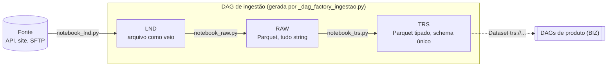
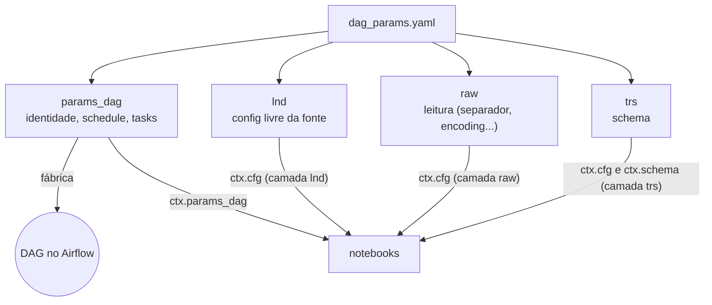
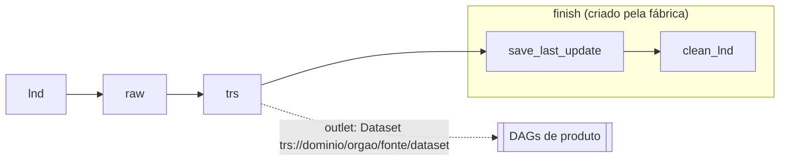
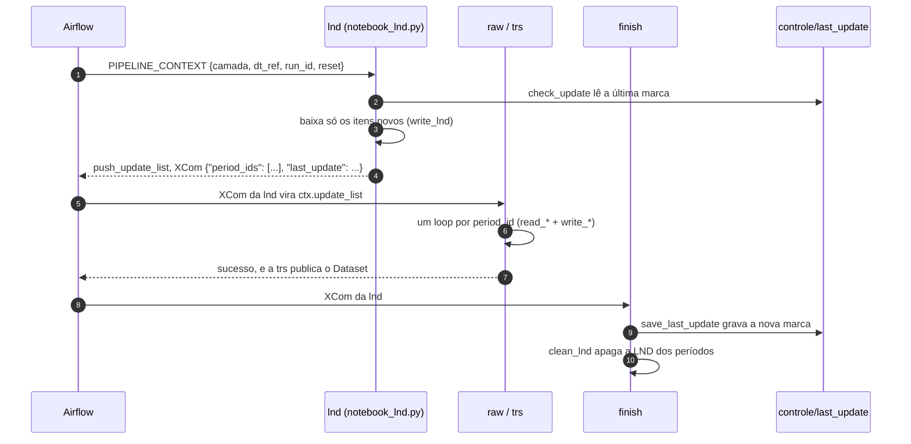
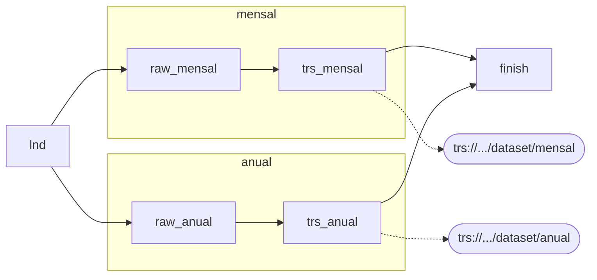
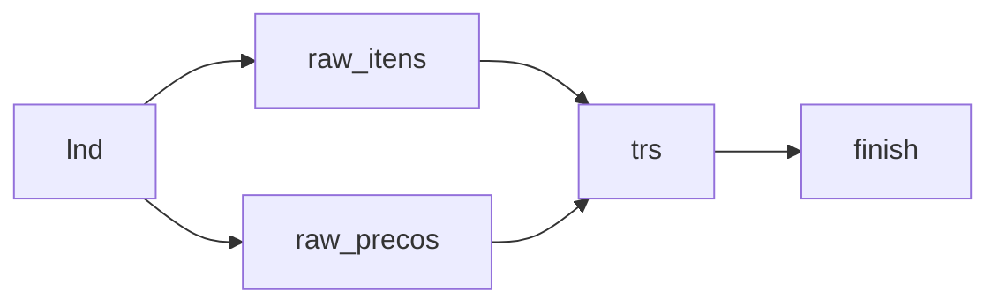
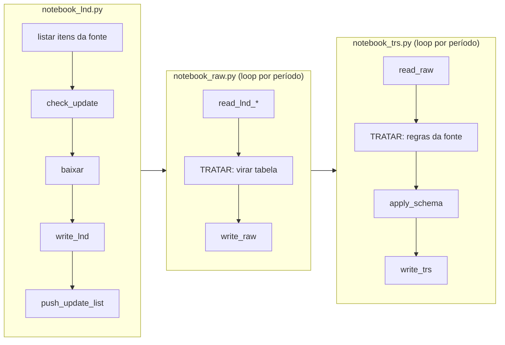
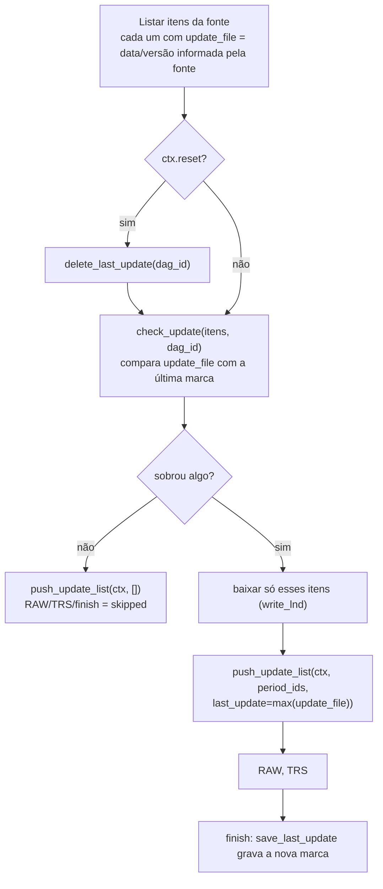
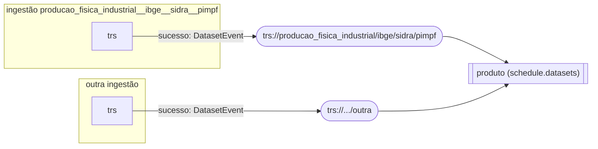

# DAGs de ingestão (LND → RAW → TRS)

Guia para criar e manter uma DAG de ingestão. Uma ingestão traz **um dataset de uma fonte** para o
data lake em três camadas e avisa os produtos (BIZ) quando a TRS muda.

> Os diagramas são [Mermaid](https://mermaid.js.org/). O GitHub os desenha. No VS Code, instale a extensão
> *Markdown Preview Mermaid Support* para vê-los no preview.

**Sumário**

1. [Visão geral](#1-visão-geral)
2. [Criar uma ingestão nova](#2-criar-uma-ingestão-nova)
3. [Parâmetros: `dag_params.yaml`](#3-parâmetros-dag_paramsyaml)
4. [Fluxo de tasks e o que passa entre elas](#4-fluxo-de-tasks-e-o-que-passa-entre-elas)
5. [Desenhos possíveis da DAG](#5-desenhos-possíveis-da-dag)
6. [Escrevendo os notebooks](#6-escrevendo-os-notebooks)
7. [Carga incremental: o que atualizar](#7-carga-incremental-o-que-atualizar)
8. [Gravação da TRS e `schema_trs.yaml`](#8-gravação-da-trs-e-schema_trsyaml)
9. [Contrato validado pelo runner](#9-contrato-validado-pelo-runner)
10. [Conexão com os produtos (BIZ)](#10-conexão-com-os-produtos-biz)
11. [Testar, rodar e diagnosticar](#11-testar-rodar-e-diagnosticar)
12. [Checklist](#12-checklist)

---

## 1. Visão geral



| Camada | Guarda | Formato | Pasta no data lake |
|---|---|---|---|
| **lnd** | o arquivo exatamente como veio da fonte; é apagado no fim da execução | o da fonte (json, csv, xlsx, parquet...) | `lnd/<dominio>/<orgao>/<fonte>/<dataset>/<period_id>/` |
| **raw** | o mesmo dado como tabela, sem limpar valores | Parquet, colunas texto + controle | `raw/.../<dataset>[/<subbase>]/<period_id>/` |
| **trs** | o dado tratado, tipado e com nomes padronizados | Parquet tipado | `trs/.../<dataset>[/<subbase>]/...` (ver [seção 8](#8-gravação-da-trs-e-schema_trsyaml)) |
| controle | última atualização e log das execuções | json / jsonl | `controle/last_update/<dag_id>.json` e `controle/.../execucoes.jsonl` |

Peças envolvidas:

- **`_dag_factory_ingestao.py`** procura `*/dag_params.yaml` nesta pasta e cria **uma DAG por pasta**.
  Pastas que começam com `_` são ignoradas.
- **`dataflow_commons`** (`src/`) guarda as funções padrão de leitura, gravação, contexto, estado e
  runner. A DAG só orquestra.
- **Notebooks** (`notebook_*.py`, formato percent `# %%`) guardam a lógica da fonte. O Airflow os roda em
  subprocesso. O mesmo arquivo roda no VS Code (venv), célula a célula.

---

## 2. Criar uma ingestão nova

**1. Escolha os 4 nomes.** O `dag_id` e o nome da pasta saem deles, em snake_case minúsculo e sem acento.

| Campo | O que é | Exemplo |
|---|---|---|
| `dominio` | área de negócio | `producao_fisica_industrial` |
| `orgao_origem` | quem produz ou é dono do dado | `ibge` |
| `fonte_dados` | sistema ou portal de onde ele é obtido | `sidra` |
| `dataset` | o conjunto de dados | `pimpf` |

`dag_id` = pasta = `producao_fisica_industrial__ibge__sidra__pimpf`. O `__` separa os níveis.

**2. Crie a pasta** copiando uma ingestão existente (ex.: `producao_fisica_industrial__ibge__sidra__pimpf`):

```
dags/ingestao/<dominio>__<orgao_origem>__<fonte_dados>__<dataset>/
├── __init__.py
├── dag_params.yaml      # identidade, agendamento, tasks e config das camadas
├── schema_trs.yaml      # colunas da TRS (um por sub-base, se houver)
├── notebook_lnd.py      # baixa da fonte e decide o que atualizar
├── notebook_raw.py      # LND -> RAW
├── notebook_trs.py      # RAW -> TRS
└── README.md            # a fonte, as regras e as particularidades desta ingestão
```

**3. Preencha o `dag_params.yaml`** ([seção 3](#3-parâmetros-dag_paramsyaml)) e o `schema_trs.yaml`
([seção 8](#8-gravação-da-trs-e-schema_trsyaml)).

**4. Escreva os notebooks** no VS Code com o kernel do venv, rodando célula a célula ([seção 6](#6-escrevendo-os-notebooks)).

**5. Valide e rode:**

```bash
docker compose exec airflow-scheduler airflow dags list-import-errors   # vazio = todas as DAGs carregaram
```

A DAG aparece na UI com a tag `ingestao` e **pausada**. Despause e dispare.

> A fábrica não derruba as outras DAGs quando um YAML está errado: ela só registra o erro no log do
> scheduler (`Falha ao criar DAG`). Se a DAG não aparecer, veja a [seção 11](#11-testar-rodar-e-diagnosticar).

---

## 3. Parâmetros: `dag_params.yaml`

O arquivo tem 4 seções. O cabeçalho do YAML de cada ingestão documenta todas as chaves.



### `params_dag`: usado pela fábrica

| Chave | Obrigatória | Padrão | Efeito |
|---|---|---|---|
| `dominio`, `orgao_origem`, `fonte_dados`, `dataset` | sim | — | identidade: `dag_id`, pastas de dados e URI do Dataset |
| `schedule` | sim | — | cron (`"0 6 * * 1"`) ou preset (`"@daily"`). `catchup=False` e `max_active_runs=1` são fixos |
| `owner` | não | `dados` | dono na UI |
| `tags` | não | `[]` | somadas à tag `ingestao` |
| `retries` | não | `2` | tentativas de cada task (intervalo de 5 min) |
| `execution_timeout_min` | não | `60` | tempo máximo de cada task |
| `tasks` | não | `lnd >> raw >> trs` | desenho da DAG ([seção 5](#5-desenhos-possíveis-da-dag)) |
| `task_groups` | não | — | grupos visuais: `{nome: {tooltip: "..."}}` |

Não preencha o `dag_id`: ele é gerado. Se aparecer no YAML, precisa ser idêntico ao gerado.

### `lnd`, `raw`, `trs`: usados pelos notebooks

O notebook da camada recebe a seção correspondente em `ctx.cfg`.

| Seção | Chaves usuais | Lida por |
|---|---|---|
| `lnd` | `fonte_dados: {url, arquivo, timeout_s, ...}`. É livre: ponha aqui URLs e parâmetros da fonte, **nunca segredos** | `ctx.cfg["fonte_dados"]` no `notebook_lnd.py` |
| `raw` | `leitura: {separador, encoding, cabecalho}` | `read_lnd_csv` e o `notebook_raw.py` |
| `trs` | `schema: schema_trs.yaml` (obrigatória) | o `get_context` carrega o schema em `ctx.schema` |
| `raw.subbases.<sb>`, `trs.subbases.<sb>` | as mesmas chaves, só para uma sub-base | mescladas sobre a seção base quando a task é da sub-base |

Senha e token vão em Connection ou Variable do Airflow, ou em variável de ambiente, nunca no YAML.

### Parâmetro do trigger: `reset`

A DAG tem um parâmetro: em **Trigger DAG w/ config**, `reset = true` faz a LND ignorar a última atualização
gravada e recarregar tudo ([seção 7](#7-carga-incremental-o-que-atualizar)).

---

## 4. Fluxo de tasks e o que passa entre elas

### DAG padrão (sem `params_dag.tasks`)



| Task | Executa | Faz |
|---|---|---|
| `lnd` | `notebook_lnd.py` | baixa da fonte o que mudou e devolve a lista de períodos (XCom) |
| `raw` | `notebook_raw.py` | converte para Parquet cada período da lista |
| `trs` | `notebook_trs.py` | trata, aplica o schema, grava e **publica o Dataset** |
| `finish.save_last_update` | runner | grava a marca de atualização (só depois de tudo dar certo) |
| `finish.clean_lnd` | runner | apaga da LND as pastas desta execução |

### O que trafega entre as tasks



O XCom da `lnd` é o elo da DAG:

| Valor de `period_ids` | Significado | RAW, TRS e finish |
|---|---|---|
| `["202501", "202502"]` | dois períodos novos | rodam um loop por período |
| `[None]` | base única (o dataset não tem período) | rodam uma vez, sem subpasta de período |
| `[]` | nada novo na fonte | ficam **skipped**, a TRS não publica o Dataset e o produto não roda |

O `last_update` é a maior data ou versão que a **fonte** informou nos itens baixados. O `finish` só o grava
se todas as tasks tiverem sucesso.

### O que cada task recebe

Os parâmetros saem dos templates do Airflow e vão para o notebook pela variável de ambiente
`PIPELINE_CONTEXT`, que o `get_context()` lê:

| Parâmetro | Origem | No notebook |
|---|---|---|
| `dt_ref` | `{{ ds }}`, a data lógica da execução | `ctx.dt_ref` (`AAAA-MM-DD`) |
| `run_id` | `{{ run_id }}` | `ctx.run_id` |
| `reset` | `{{ params.reset }}`, só na LND | `ctx.reset` |
| `update` | `{{ ti.xcom_pull(task_ids='lnd') }}`, em RAW, TRS e finish | `ctx.update_list` |
| `subbase` | nome do notebook (`notebook_raw_<subbase>.py`) | `ctx.subbase` |

### Falhas e reprocesso

- Se uma task falha, o `finish` não roda e a marca **não avança**. A próxima execução agendada baixa os
  mesmos itens de novo.
- Para retomar a mesma execução, use **Clear** na task que falhou e nas seguintes: o XCom da `lnd`
  continua lá.
- Cada período é regravado na pasta dele, sem tocar nos outros.
- Recarga completa: **Trigger DAG w/ config** com `{"reset": true}`.

---

## 5. Desenhos possíveis da DAG

Sem `params_dag.tasks`, a DAG é a padrão. Ao declarar `tasks`, declare **todas**, inclusive a `lnd`.

| Chave por task | Obrigatória | Descrição |
|---|---|---|
| (a chave) | sim | o `task_id`, em snake_case. `finish` é reservado |
| `notebook` | sim | `notebook_<lnd\|raw\|trs>[_<subbase>].py`. **A camada e a sub-base vêm do nome** |
| `dependencies` | não | lista de `task_id` que precisam terminar antes |
| `task_group` | não | um grupo declarado em `params_dag.task_groups` |
| `retries` | não | sobrescreve `params_dag.retries` |
| `trigger_rule` | não | `all_success` (padrão), `all_done`, `none_failed`, `one_success`... |

Regras validadas ao carregar: exatamente **uma** task de LND (que não tem sub-base); notebook único por task;
dependências existentes e sem ciclo; arquivos presentes.

O grupo `finish` sempre entra depois das tasks **finais**, as que nenhuma outra task tem como dependência.

### A) Padrão: uma base

```yaml
params_dag:
  # sem 'tasks'
```


### B) Sub-bases: um download, várias tabelas

Quando o arquivo da fonte traz dados de naturezas diferentes (ex.: mensal e anual), use uma RAW e uma TRS
por sub-base, cada uma com o seu notebook e o seu schema. Isso gera **uma TRS e um Dataset por sub-base**.

```yaml
params_dag:
  task_groups:
    mensal: {tooltip: "Sub-base mensal"}
    anual:  {tooltip: "Sub-base anual"}
  tasks:
    lnd:        {notebook: notebook_lnd.py}
    raw_mensal: {notebook: notebook_raw_mensal.py, dependencies: [lnd], task_group: mensal}
    trs_mensal: {notebook: notebook_trs_mensal.py, dependencies: [raw_mensal], task_group: mensal}
    raw_anual:  {notebook: notebook_raw_anual.py,  dependencies: [lnd], task_group: anual}
    trs_anual:  {notebook: notebook_trs_anual.py,  dependencies: [raw_anual], task_group: anual, retries: 0}
raw:
  leitura: {separador: ";", encoding: utf-8, cabecalho: true}
  subbases:
    anual: {leitura: {separador: ","}}          # mescla sobre raw.leitura só para a sub-base anual
trs:
  subbases:
    mensal: {schema: schema_trs_mensal.yaml}
    anual:  {schema: schema_trs_anual.yaml}
```



| Item | Caminho / URI |
|---|---|
| RAW da sub-base | `raw/.../<dataset>/mensal/<period_id>/` |
| TRS da sub-base | `trs/.../<dataset>/mensal/...` |
| Dataset | `trs://<dominio>/<orgao>/<fonte>/<dataset>/mensal` |
| Arquivos de cada sub-base na LND | `read_lnd_csv(ctx, spark, pid, padrao="mensal_*.csv")` |

### C) Uma TRS que depende de duas RAWs

```yaml
  tasks:
    lnd:        {notebook: notebook_lnd.py}
    raw_itens:  {notebook: notebook_raw_itens.py,  dependencies: [lnd]}
    raw_precos: {notebook: notebook_raw_precos.py, dependencies: [lnd]}
    trs:        {notebook: notebook_trs.py,        dependencies: [raw_itens, raw_precos]}
```



Para ler cada sub-base, o notebook da TRS sem sub-base usa os caminhos ou cria um `ctx` por sub-base
(`get_context(camada="raw", subbase="itens", ...)`).

### D) `trigger_rule`: seguir mesmo com falha

`trigger_rule: all_done` em uma task faz ela rodar mesmo se uma dependência falhar (útil para uma TRS
"parcial"). Lembre que o `finish` exige **tudo em sucesso**: com qualquer falha, a marca não avança.

---

## 6. Escrevendo os notebooks

Cada notebook segue **LER (padrão) → TRATAR (livre) → GRAVAR (padrão)**:



| Camada | LER | TRATAR | GRAVAR |
|---|---|---|---|
| lnd | livre: `requests`, `lnd.make_request_with_retries`, `lnd.baixar_http`, SFTP... | nenhum | `write_lnd(ctx, sub_path, conteudo, tipo_arquivo)` + `push_update_list` |
| raw | `read_lnd_csv`, `read_lnd_parquet`, `read_lnd_excel`, `df_from_pandas` | só o necessário para virar **tabela** (pular linhas, escolher aba). Não limpe valores | `write_raw(ctx, df, period_id, normalizar=True)` |
| trs | `read_raw(ctx, spark, period_id)` (+ `union_by_name`) | regras da fonte: símbolos, unificar colunas, filtros | `apply_schema(df, ctx.schema)` + `write_trs(...)` |

### O contexto (`ctx`)

`ctx = get_context(camada=...)` carrega tudo da camada. No Airflow, os valores vêm do `PIPELINE_CONTEXT`.
No venv, passe-os como argumentos.

| Atributo | Conteúdo |
|---|---|
| `ctx.camada`, `ctx.subbase` | `lnd`/`raw`/`trs` e a sub-base da task |
| `ctx.dt_ref`, `ctx.run_id` | data lógica e id da execução |
| `ctx.params_dag`, `ctx.dag_id` | seção `params_dag` e o id gerado |
| `ctx.dominio`, `ctx.orgao_origem`, `ctx.fonte_dados`, `ctx.dataset` | identidade |
| `ctx.cfg` | seção da camada no YAML, com a sub-base mesclada |
| `ctx.schema` | colunas do `schema_trs.yaml` (só na TRS) |
| `ctx.update_list` | `period_ids` vindos da LND (RAW e TRS) |
| `ctx.reset` | recarga completa pedida no trigger (LND) |
| `ctx.app_name` | nome para a sessão Spark (`criar_spark(ctx.app_name)`) |

### Modelo mínimo de cada notebook

```python
# notebook_lnd.py
ctx = get_context(camada="lnd")
log = logging.getLogger(ctx.dag_id)               # o logging só aparece depois do get_context
if ctx.reset:
    delete_last_update(ctx.dag_id)

itens = [{"period_id": "202501", "update_file": date(2025, 3, 10)}, ...]   # o que a FONTE informa
novos = check_update(itens, ctx.dag_id)            # só o que mudou desde a última marca
for item in novos:
    conteudo = lnd.make_request_with_retries(url.format(**item)).content
    write_lnd(ctx, item["period_id"], conteudo, "json")
push_update_list(ctx, [i["period_id"] for i in novos],
                 last_update=max((i["update_file"] for i in novos), default=None))
```

```python
# notebook_raw.py
if "PIPELINE_CONTEXT" in os.environ:
    ctx = get_context(camada="raw")                            # Airflow: a lista vem da LND
else:
    ctx = get_context(camada="raw", update_list=["202501"])    # venv: teste manual
spark = criar_spark(ctx.app_name)
for period_id in ctx.update_list:
    df = read_lnd_csv(ctx, spark, period_id)
    write_raw(ctx, df, period_id, normalizar=True)
spark.stop()
```

```python
# notebook_trs.py
ctx = get_context(camada="trs")                    # no venv: update_list=[...]
spark = criar_spark(ctx.app_name)
for period_id in ctx.update_list:
    df = read_raw(ctx, spark, period_id)
    df = df.withColumn("VALOR", F.when(F.col("VALOR").isin("..", "...", "-"), None).otherwise(F.col("VALOR")))
    df = apply_schema(df, ctx.schema)
    write_trs(ctx, df, period_id)                   # ou partition_by=..., ver seção 8
spark.stop()
```

Boas práticas:

- Use `log.info(...)` em vez de `print`: o runner repassa o nível real (INFO, WARNING, ERROR) ao log
  da task.
- Não capture exceção para "seguir em frente". Um erro precisa derrubar a task, com o traceback; senão a
  marca avança com dado faltando. Se tratar falhas por período, junte-as e lance um erro no fim (ver a LND da PIM-PF).
- Não use `datetime.now()` para dados. Use `ctx.dt_ref`, o `period_id` e as datas que a fonte informa.
- Imports pesados ficam no notebook, não no YAML nem na DAG.
- Colunas sempre em MAIÚSCULO (`normalizar=True` na RAW, `destino` em maiúsculo no schema).
- Os notebooks ficam em `.airflowignore`: o scheduler nunca os importa, porque importar seria executar a carga.

### Colunas técnicas

| Coluna | Criada por | Onde fica |
|---|---|---|
| `_NM_ARQUIVO_LND` | `read_lnd_*` / `df_from_pandas` | RAW |
| `_DH_INGESTAO_RAW` | `read_lnd_*` / `df_from_pandas` (ou `write_raw`, se faltar) | RAW |
| `_DH_INGESTAO_TRS` | `read_raw`, que remove as duas acima | TRS (o `apply_schema` a mantém) |

Não existe coluna de período: o período é a **pasta** (ou a partição).

---

## 7. Carga incremental: o que atualizar

A LND decide o que atualizar, no notebook. Nem o YAML nem o contexto decidem.



`check_update(list_update, dag_id, campo="update_file", comparacao=">")`:

| Situação | Retorno |
|---|---|
| sem marca gravada (primeira carga ou `reset`) | todos os itens |
| com marca | os itens com `update_file <comparacao> marca`. O padrão `>` traz só os mais novos; use `">="` para rebaixar também o item da última data |
| tipos aceitos em `update_file` | `date`, `datetime`, `int` ou texto ISO, sem misturar tipos na mesma lista |

A marca fica em `data_lake/controle/last_update/<dag_id>.json`, gravada pelo `finish`. **O venv e o Airflow
usam o mesmo arquivo**: rodar a LND no venv e depois a DAG pode resultar em "nada novo".

---

## 8. Gravação da TRS e `schema_trs.yaml`

### `apply_schema(df, ctx.schema)`

Seleciona, renomeia e converte as colunas do schema (`origem` → `destino`, `cast(tipo)`) e mantém
`_DH_INGESTAO_TRS`. As colunas fora do schema são descartadas. Se uma coluna `origem` não existe ou um tipo
é inválido, a task falha com a coluna no erro.

> **Atenção:** um valor que não converte (texto em coluna `double`) vira **NULL** sem erro. Trate os
> símbolos da fonte (`..`, `...`, `-`, `X`), a vírgula decimal e as datas no TRATAR, antes do `apply_schema`,
> e confira o resultado no notebook (ex.: conte os NULL e registre um WARNING).
> Cada coluna aceita só `origem`, `destino`, `tipo` e `descricao`: chave desconhecida é erro.

```yaml
colunas:
  - origem: VARIAVEL_CODIGO          # nome na RAW (já normalizado pelo write_raw)
    destino: CD_VARIAVEL             # nome na TRS, MAIÚSCULO, com prefixo
    tipo: string                     # string | int | bigint | double | float | boolean | date | timestamp | decimal(p,s)
    descricao: Código da variável no SIDRA
  - origem: DATA                     # no notebook: F.to_date("DATA", "dd/MM/yyyy") antes do apply_schema
    destino: DT_REFERENCIA
    tipo: date
```

Prefixos de coluna: `CD_` código, `ID_`, `NM_` nome, `DS_` descrição, `SG_` sigla, `NR_` número,
`QT_` quantidade, `VL_` valor, `PC_` percentual, `DT_` data, `DH_` data e hora, `FL_` indicador.
Códigos são identificadores: deixe como `string`, mesmo que sejam numéricos.

### `write_trs(ctx, df, sub_path=None, partition_by=None, mode="overwrite", options=None)`

O notebook escolhe uma das três formas:

| Forma | Chamada | Resultado no disco | Quando usar |
|---|---|---|---|
| pasta por período | `write_trs(ctx, df, period_id)` dentro do loop | `trs/.../<dataset>/202501/part-*.parquet` | o período da fonte é a unidade de carga |
| partição Spark | `write_trs(ctx, df, partition_by="CD_MES_ANO")` | `trs/.../<dataset>/CD_MES_ANO=202501/` | o período é uma coluna do dado. Com *dynamic overwrite*, só as partições presentes no DataFrame são regravadas (padrão da PIM-PF) |
| base única | `write_trs(ctx, df)` | `trs/.../<dataset>/part-*.parquet` sobrescrito | dataset pequeno e sem período (`update_list == [None]`) |

- `options` vai direto ao writer do Spark (ex.: `{"compression": "zstd"}`). O padrão é `snappy` e, com
  `partition_by`, `partitionOverwriteMode=dynamic`.
- Uma coluna de partição não pode começar com `_`.
- Para ler a TRS inteira em qualquer formato: `read_trs(ctx, spark)` ou, fora da ingestão,
  `read_trs_uri(spark, "trs://...")`.

---

## 9. Contrato validado pelo runner

O `runner.run_layer` executa o notebook em subprocesso e, ao final, confere se ele **gravou nesta
execução** (por data de modificação). Isso vale mesmo para um notebook customizado:

| Camada | Exige |
|---|---|
| lnd | ter chamado `push_update_list`, e arquivo novo em `lnd/.../<period_id>/` para cada período |
| raw | Parquet novo em `raw/.../<period_id>/` para cada período |
| trs | Parquet novo na TRS e, quando a pasta do período existe, Parquet novo nela |

Um notebook que termina sem gravar falha, mesmo que haja dados antigos na pasta. Todas as execuções ficam
registradas em `data_lake/controle/<dominio>/<orgao>/<fonte>/<dataset>/execucoes.jsonl` (início, fim,
falha, pulado, atualização, limpeza).

---

## 10. Conexão com os produtos (BIZ)

A task de cada TRS publica um **Dataset** do Airflow cujo URI é também o endereço do dado:

```
trs://<dominio>/<orgao_origem>/<fonte_dados>/<dataset>[/<subbase>]
        └── get_path_uri() ──> data_lake/trs/<dominio>/<orgao_origem>/<fonte_dados>/<dataset>[/<subbase>]
```



- O evento só nasce quando a task `trs` termina com **sucesso**. Com `[]` (nada novo), a TRS fica *skipped*
  e os produtos não são disparados.
- O produto declara os URIs em `schedule.datasets` e lê a TRS com `read_trs_uri(spark, uri)`. Veja
  [`dags/produto/README.md`](../produto/README.md).
- **Mudar a identidade** de uma ingestão (os 4 nomes ou a sub-base) muda o URI e a pasta: atualize os
  produtos que dependem dela.
- Na UI, o menu **Datasets** mostra quem produz e quem consome cada URI e o histórico de eventos.

---

## 11. Testar, rodar e diagnosticar

### No venv (desenvolvimento)

```bash
source ~/.venvs/dataflow/bin/activate
cd dags/ingestao/<dag_id>
python notebook_lnd.py          # ou célula a célula no VS Code
```

- Rode a partir da pasta da ingestão (ou passe `pkg_dir=` ao `get_context`).
- Na RAW e na TRS, passe `update_list=[...]` no `get_context`. Base única: `[None]`.
- **Os dados são os mesmos do Airflow** (`data_lake/`), inclusive a marca `last_update`.

### No container (execução real)

```bash
docker compose exec airflow-scheduler airflow dags list-import-errors
docker compose exec airflow-scheduler airflow tasks test <dag_id> lnd 2026-11-08
docker compose logs --tail=100 airflow-scheduler | grep -A12 "Falha ao criar DAG"
```

`airflow tasks test` não grava estado nem XCom no banco e **não publica eventos de Dataset**. Para testar
a cadeia inteira até o produto, use **Trigger DAG** na UI.

### Problemas comuns

| Sintoma | Causa provável |
|---|---|
| A DAG não aparece | YAML inválido, nome da pasta diferente do `dag_id` ou notebook/schema ausente. Veja o log do scheduler (`Falha ao criar DAG`) |
| Import error em `notebook_*.py` | o notebook não está casando com `dags/.airflowignore` (nome fora do padrão) |
| RAW e TRS *skipped* | a LND devolveu `[]`: nada mais novo que a marca. Use `reset` ou confira a `comparacao` |
| `RAW sem Parquet gravado nesta execução` | o notebook não gravou um dos períodos da lista (loop, `sub_path` errado) |
| `não chamou push_update_list` | a LND terminou sem declarar a lista |
| Coluna toda NULL na TRS | o `cast` falhou em silêncio: trate os símbolos ou o formato antes do `apply_schema` |
| `FileNotFoundError /opt/airflow/data_lake/...` | a pasta `data_lake` foi recriada com o container no ar: `docker compose up -d --force-recreate` |

---

## 12. Checklist

- [ ] Pasta = `dominio__orgao_origem__fonte_dados__dataset`, em snake_case e sem acento
- [ ] `dag_params.yaml` com os 4 nomes, `schedule` e `trs.schema`, sem segredos
- [ ] LND: `check_update` com o `update_file` informado pela fonte, `write_lnd` e `push_update_list` com o `last_update`
- [ ] RAW: loop em `ctx.update_list` e `write_raw(..., normalizar=True)`
- [ ] TRS: símbolos tratados, `apply_schema` e `write_trs` (pasta, partição ou base única)
- [ ] `schema_trs.yaml` com `destino` em MAIÚSCULO e com prefixo; datas e decimais convertidos no notebook
- [ ] `log.info` em vez de `print`; nenhuma exceção engolida
- [ ] `README.md` da pasta: fonte, periodicidade, regras e particularidades
- [ ] `airflow dags list-import-errors` vazio
- [ ] Primeira execução pela UI e o Dataset aparecendo em **Datasets**
