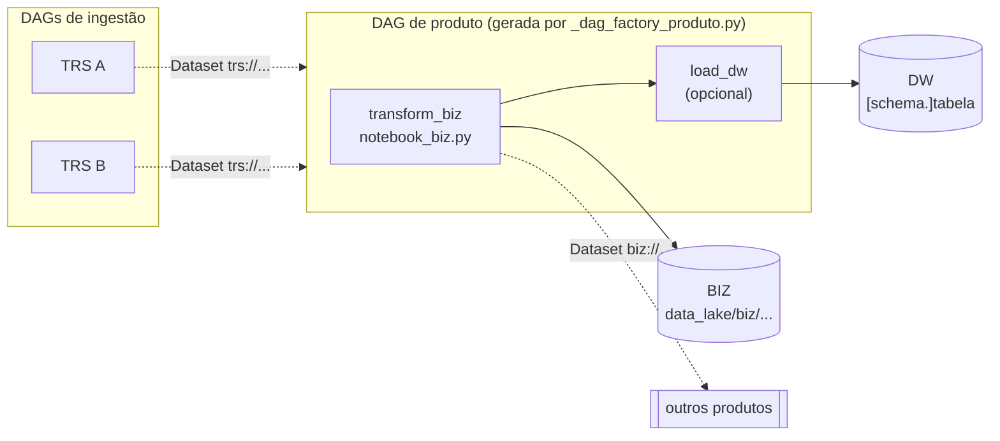
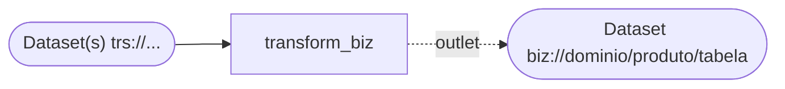
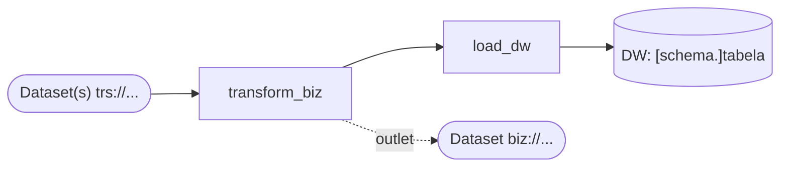
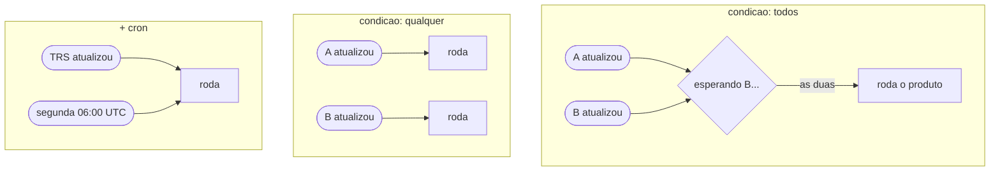
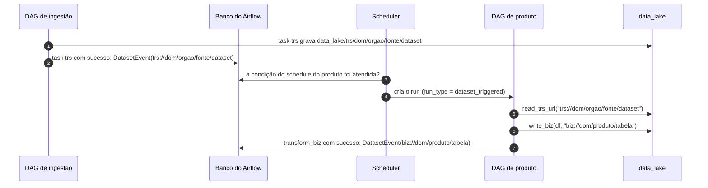
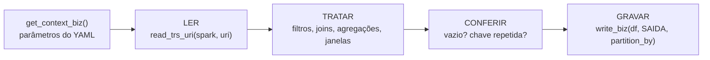
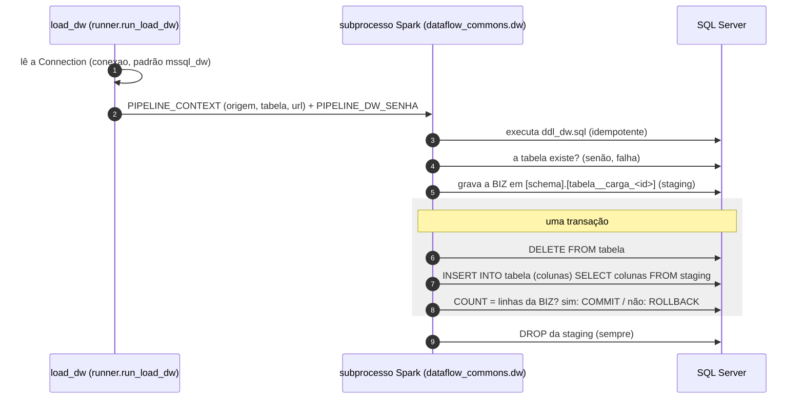

# DAGs de produto (BIZ)

Guia para criar e manter uma DAG de produto. Um produto aplica **regras de negócio** sobre uma ou mais TRS
e grava o resultado na camada **BIZ** do data lake e, opcionalmente, numa tabela do DW.

> Os diagramas são [Mermaid](https://mermaid.js.org/). O GitHub os desenha. No VS Code, instale a extensão
> *Markdown Preview Mermaid Support* para vê-los no preview.

**Sumário**

1. [Visão geral](#1-visão-geral)
2. [Criar um produto novo](#2-criar-um-produto-novo)
3. [Parâmetros: `dag_params.yaml`](#3-parâmetros-dag_paramsyaml)
4. [Fluxo de tasks](#4-fluxo-de-tasks)
5. [Quando o produto roda: agendamento por Dataset](#5-quando-o-produto-roda-agendamento-por-dataset)
6. [Conexão entre ingestão e produto](#6-conexão-entre-ingestão-e-produto)
7. [Escrevendo o `notebook_biz.py`](#7-escrevendo-o-notebook_bizpy)
8. [Contrato validado pelo runner](#8-contrato-validado-pelo-runner)
9. [Carga no DW (`load_dw`)](#9-carga-no-dw-load_dw)
10. [Testar, rodar e diagnosticar](#10-testar-rodar-e-diagnosticar)
11. [Limitações atuais e próximos passos](#11-limitações-atuais-e-próximos-passos)
12. [Checklist](#12-checklist)

---

## 1. Visão geral



Regras da camada:

- A BIZ lê **somente da TRS**, nunca da LND ou da RAW.
- Um produto é uma pasta `<dominio>__<produto>/` com `dag_params.yaml`, `notebook_biz.py` e `README.md`.
- A fábrica `_dag_factory_produto.py` cria uma DAG por pasta. `dag_id` = `<dominio>__<produto>` = nome da pasta.
  Pastas que começam com `_` são ignoradas.
- A DAG só orquestra. As regras ficam no notebook; o código comum, no `dataflow_commons`.

Exemplo em produção: [`producao_fisica_industrial__industria_transformacao/`](producao_fisica_industrial__industria_transformacao/README.md),
o índice de cada atividade da Indústria de Transformação comparado com a média da UF no mês.

---

## 2. Criar um produto novo

**1. Escolha os nomes**, em snake_case minúsculo e sem acento:

| Campo | O que é | Exemplo |
|---|---|---|
| `dominio` | área de negócio (em geral, a mesma da TRS principal) | `producao_fisica_industrial` |
| `produto` | o que o produto entrega | `industria_transformacao` |
| tabela de saída | cada tabela que o produto grava | `indice_atividade_uf` |

**2. Crie a pasta:**

```
dags/produto/<dominio>__<produto>/
├── dag_params.yaml      # identidade, agendamento e tasks
├── notebook_biz.py      # LER a TRS -> TRATAR (regra de negócio) -> GRAVAR na BIZ
├── ddl_dw.sql           # só com load_dw: CREATE TABLE idempotente da tabela do DW
└── README.md            # pedido do negócio, recorte, colunas, chave e reprocesso
```

Não há `__init__.py` nem `dag.py`: a fábrica cria a DAG.

**3. Preencha o `dag_params.yaml`** ([seção 3](#3-parâmetros-dag_paramsyaml)).

**4. Escreva o notebook** no VS Code, com o kernel do venv ([seção 7](#7-escrevendo-o-notebook_bizpy)).

**5. Valide e rode:**

```bash
docker compose exec airflow-scheduler airflow dags list-import-errors   # vazio = todas as DAGs carregaram
```

A DAG aparece com a tag `produto` e **pausada**. Despause: a partir daí ela roda a cada atualização das TRS.

---

## 3. Parâmetros: `dag_params.yaml`

```yaml
params_dag:
  dominio: producao_fisica_industrial
  produto: industria_transformacao        # dag_id = dominio__produto (gerado)
  schedule:
    datasets:                             # TRS que disparam o produto
      - trs://producao_fisica_industrial/ibge/sidra/pimpf
    condicao: todos                       # todos (E) | qualquer (OU)
    # cron: "0 6 * * 1"                   # opcional: roda também nesse horário (UTC)
  owner: dados
  tags: [producao_fisica_industrial]
  retries: 2
  execution_timeout_min: 30

tasks:
  transform_biz:                          # obrigatória
    saida: biz://producao_fisica_industrial/industria_transformacao/indice_atividade_uf
    parametros:                           # opcional, livre: chega ao notebook em ctx.parametros
      ano: "2025"
      cd_variavel_indice: "12606"
    # retries: 0                          # opcional: sobrescreve params_dag.retries
  load_dw:                                # opcional
    tabela: biz.indice_atividade_uf       # [schema.]tabela
    # conexao: mssql_dw                   # opcional: conn_id da Connection do Airflow
```

### `params_dag`

| Chave | Obrigatória | Padrão | Efeito |
|---|---|---|---|
| `dominio`, `produto` | sim | — | identidade. Precisam ser snake_case, sem `__` |
| `schedule.datasets` | sim | — | lista de URIs `trs://...`, sem repetição ([seção 5](#5-quando-o-produto-roda-agendamento-por-dataset)) |
| `schedule.condicao` | não | `todos` | `todos`: espera **todas** as TRS atualizarem. `qualquer`: roda com a primeira |
| `schedule.cron` | não | — | 5 campos, UTC. Roda **também** nesse horário, mesmo sem TRS nova |
| `owner` | não | `dados` | dono na UI |
| `tags` | não | `[]` | somadas à tag `produto` |
| `retries` | não | `2` | tentativas por task (intervalo de 5 min) |
| `execution_timeout_min` | não | `60` | tempo máximo de cada task |

### `tasks`

| Task | Obrigatória | Chaves | Efeito |
|---|---|---|---|
| `transform_biz` | sim | `saida` (obrigatória), `parametros`, `retries` | roda `notebook_biz.py`, que precisa gravar em `saida`. Publica o Dataset `saida`. `parametros` é um mapa livre (chaves em snake_case) com o recorte do produto: ano, códigos, filtros |
| `load_dw` | não | `tabela` (obrigatória), `conexao` (padrão `mssql_dw`), `retries` | recarrega a tabela do DW com a `saida` ([seção 9](#9-carga-no-dw-load_dw)) |

Validações feitas ao carregar (`dataflow_commons/config_produto.py`):

- chaves desconhecidas são rejeitadas (erro de digitação não passa em silêncio);
- `saida` precisa estar dentro do produto: `biz://<dominio>/<produto>/<tabela>`;
- os URIs precisam ter o formato certo, com partes em snake_case;
- a pasta precisa se chamar `<dominio>__<produto>`;
- o `notebook_biz.py` precisa existir.

Senha, token e string de conexão nunca vão no YAML: o YAML só nomeia a Connection do Airflow (`conexao`).

---

## 4. Fluxo de tasks

### Só `transform_biz`



### Com `load_dw`



| Task | Executa | Recebe | Faz |
|---|---|---|---|
| `transform_biz` | `runner.run_biz` → `notebook_biz.py` (subprocesso) | `saida`, `dt_ref` (`{{ ds }}`), `run_id` | lê a TRS, aplica as regras e grava em `saida`. O runner confere o Parquet novo e publica o Dataset da `saida` |
| `load_dw` | `runner.run_load_dw` → `python -m dataflow_commons.dw` (subprocesso com Spark) | `origem` (= `saida`), `tabela`, `conexao`, `pkg_dir`, `dt_ref`, `run_id` | executa o `ddl_dw.sql` e recarrega a tabela do DW de forma atômica |

O notebook obtém tudo com `ctx = get_context_biz()`, que lê o `dag_params.yaml` da pasta do produto,
igual no venv e no Airflow:

| Atributo | Origem |
|---|---|
| `ctx.entradas` | `params_dag.schedule.datasets` (lista de `trs://...`) |
| `ctx.saida` | `tasks.transform_biz.saida` |
| `ctx.parametros` | `tasks.transform_biz.parametros` (`{}` se ausente) |
| `ctx.dag_id`, `ctx.dominio`, `ctx.produto`, `ctx.app_name` | identidade |
| `ctx.dt_ref`, `ctx.run_id` | do Airflow (`PIPELINE_CONTEXT`, montado pelo `runner.run_biz`); no venv, hoje e `manual` |

Se a `transform_biz` falhar, o Dataset `biz://` não é publicado e a `load_dw` não roda. Corrija e use
**Clear** na task, ou **Trigger DAG**.

---

## 5. Quando o produto roda: agendamento por Dataset

O produto não tem horário fixo: ele roda quando as TRS de que depende são atualizadas. Quem cuida disso é o
próprio Airflow (*data-aware scheduling*). A fábrica traduz o `schedule` do YAML assim:

Na visão *Graph*, o Dataset e a condição aparecem à esquerda **sem linha até a primeira task**: eles
disparam a DAG inteira, não uma task. A ordem entre as tasks (`transform_biz` → `load_dw`) é a linha entre elas.

| YAML | Objeto no Airflow | Roda quando |
|---|---|---|
| `datasets: [A]` | `DatasetAll(A)` | A atualiza |
| `datasets: [A, B]`, `condicao: todos` | `DatasetAll(A, B)` ≡ `A & B` | **as duas** atualizaram desde a última execução do produto |
| `datasets: [A, B]`, `condicao: qualquer` | `DatasetAny(A, B)` ≡ `A \| B` | **qualquer uma** atualiza |
| `+ cron: "0 6 * * 1"` | `DatasetOrTimeSchedule(CronTriggerTimetable(...), datasets=...)` | na condição acima **ou** no horário do cron |



Como escolher:

- **`todos`**: o produto cruza as bases e só faz sentido com todas atualizadas (ex.: produção × preços do mesmo mês).
- **`qualquer`**: as bases são independentes, ou o produto deve refletir cada novidade logo.
- **`cron`**: uma das fontes atualiza muito raramente e o produto precisa rodar numa cadência mínima, ou o
  negócio quer o resultado num dia fixo. Ele **não verifica** se algo mudou: o notebook recalcula com o que
  houver na TRS.

> Com `todos`, se A atualiza duas vezes antes de B, o produto roda uma vez só, quando B chegar. Os eventos
> se acumulam, não se perdem.

---

## 6. Conexão entre ingestão e produto

O **URI do Dataset é o endereço do dado**. A mesma string serve para agendar (Airflow), ler e gravar
(`get_path_uri`):

```
trs://<dominio>/<orgao_origem>/<fonte_dados>/<dataset>[/<subbase>]  ->  data_lake/trs/<...>
biz://<dominio>/<produto>/<tabela>                                  ->  data_lake/biz/<...>
```



O que é bom saber:

- **`Dataset("trs://...")` é só um nome.** O Airflow não abre a pasta nem confere se há dado. O que indica
  "dado novo" é o **DatasetEvent**, que nasce quando a task produtora termina com sucesso. Para ver os eventos:
  menu **Datasets** na UI.
- **Ingestão sem novidade não dispara o produto.** Se a LND devolve `[]`, a TRS fica *skipped* e não há evento.
- **O URI precisa bater letra por letra** com o da ingestão. Para encontrá-lo, monte-o com os 4 nomes do
  `dag_params.yaml` da ingestão (e a sub-base, se houver) ou consulte o menu **Datasets**. Um URI errado
  passa na validação (o formato está certo), mas o produto **nunca roda**.
- **Mudou a identidade de uma ingestão?** O URI e a pasta mudam: atualize o `schedule.datasets` e o notebook
  dos produtos.
- **Produto de produto:** a `saida` (`biz://...`) também é publicada como Dataset, mas hoje o
  `schedule.datasets` aceita só `trs://` (regra: a BIZ lê só da TRS). Encadear produtos exige mudar essa regra.

---

## 7. Escrevendo o `notebook_biz.py`

Mesmo padrão das outras camadas: **LER (padrão) → TRATAR (livre) → GRAVAR (padrão)**.



```python
import logging
from pyspark.sql import functions as F

from dataflow_commons.context import get_context_biz
from dataflow_commons.readers import read_trs_uri
from dataflow_commons.spark import criar_spark
from dataflow_commons.writers import write_biz

ctx = get_context_biz()                              # lê o dag_params.yaml e liga o logging
log = logging.getLogger(ctx.dag_id)

ENTRADA = ctx.entradas[0]                            # schedule.datasets
SAIDA = ctx.saida                                    # tasks.transform_biz.saida
ANO = ctx.parametros["ano"]                          # tasks.transform_biz.parametros

spark = criar_spark(ctx.app_name)
trs = read_trs_uri(spark, ENTRADA)                   # TRS inteira (pastas de período ou partições)

biz = (trs.filter(F.col("NM_MES_ANO").endswith(ANO)) # TRATAR: regra de negócio
          .groupBy(...).agg(...)).cache()

if biz.count() == 0:                                 # CONFERIR: falhar é melhor que gravar errado
    raise ValueError("Nenhum registro no recorte: a TRS chegou até o período esperado?")

write_biz(biz, SAIDA, partition_by="CD_MES_ANO")     # GRAVAR
spark.stop()
```

### Funções

| Função | Uso |
|---|---|
| `read_trs_uri(spark, "trs://...")` | lê a TRS inteira, com as colunas de partição. Falha se a pasta não existe |
| `write_biz(df, "biz://...", partition_by=None, mode="overwrite", options=None)` | grava Parquet no caminho do URI. Com `partition_by`, *dynamic overwrite*: só as partições presentes no DataFrame são regravadas |
| `get_path_uri(uri)` | o caminho no disco de um URI (para inspecionar ou ler com pandas) |
| `get_context_biz(pkg_dir=None)` | contexto do produto lido do `dag_params.yaml`; liga o `logging` (o runner repassa o nível de cada linha ao log da task) |
| `criar_spark(nome)` | sessão Spark `local[*]` padrão do projeto |

### Gravação

| Escolha | Chamada | Efeito em cada execução |
|---|---|---|
| sem partição | `write_biz(df, SAIDA)` | a tabela inteira é substituída |
| particionada | `write_biz(df, SAIDA, partition_by="CD_MES_ANO")` | só os meses presentes no DataFrame são regravados; os outros ficam como estão |
| várias tabelas | uma `write_biz` por tabela | só a `saida` do YAML é validada e publicada como Dataset. As demais tabelas também precisam ficar em `biz://<dominio>/<produto>/...` |

### Boas práticas

- **Ler só da TRS**, sempre pelo URI. Se o produto precisa de outra fonte, crie a ingestão dela primeiro.
- **Colunas em MAIÚSCULO e com prefixo** (`CD_`, `NM_`, `VL_`, `QT_`, `DT_`...), como na TRS.
- **Confira antes de gravar**: resultado vazio, chave repetida, totais. Lance `ValueError` com uma mensagem
  que diga o que olhar.
- **Recorte no YAML, regra no notebook**: valores que definem o recorte ou mudam com o tempo (ano, códigos, filtros) vão em `tasks.transform_biz.parametros`. A lógica (filtros, joins, janelas, cálculos) fica no notebook.
- **Nulo não é zero**: um "sem dado" da fonte deve ficar fora de médias e somas, não virar `0`.
- **Não use `datetime.now()` para regra de dado.** Num run disparado por Dataset, o `dt_ref` é a data do
  disparo, não a do período do dado. Use o período presente na própria TRS.
- `log.info` em vez de `print`, e nenhuma exceção engolida.

---

## 8. Contrato validado pelo runner

O `runner.run_biz` executa o notebook em subprocesso e só considera a task bem-sucedida se:

1. o notebook terminou com código 0;
2. há Parquet **gravado nesta execução** (por data de modificação) sob `get_path_uri(saida)`.

Um notebook que roda e não grava na `saida` falha, mesmo que haja dados antigos. Isso impede publicar um
Dataset `biz://` sem dado novo.

---

## 9. Carga no DW (`load_dw`)

A task `load_dw` copia a tabela da BIZ para o DW (SQL Server) pelo **JDBC do Spark**. Cada execução é uma
**recarga completa e atômica**: se algo falha, a tabela do DW fica exatamente como estava.



### `ddl_dw.sql`

A tabela de destino é criada pelo DDL da pasta do produto, e não pelo Spark: se o Spark criasse a tabela,
todo texto viraria `NVARCHAR(MAX)`, sem chave nem índice. O arquivo roda **antes de toda carga**, então
precisa ser **idempotente**. Os lotes são separados por `GO`, como no SSMS.

```sql
IF OBJECT_ID(N'biz.indice_atividade_uf', N'U') IS NULL
CREATE TABLE biz.indice_atividade_uf (
    CD_MES_ANO    CHAR(6)       NOT NULL,
    -- ... demais colunas da BIZ (CD_UF, CD_SETOR_CNAE_20, ...)
    NM_UF         NVARCHAR(40)  NOT NULL,          -- NVARCHAR para acentos
    VL_INDICE     FLOAT         NOT NULL,
    _DH_CARGA_DW  DATETIME2(0)  NOT NULL DEFAULT SYSUTCDATETIME(),   -- coluna fora da BIZ: precisa de DEFAULT
    CONSTRAINT PK_indice_atividade_uf PRIMARY KEY (CD_UF, CD_MES_ANO, CD_SETOR_CNAE_20)
);
GO
```

- O `INSERT` usa os **nomes** das colunas da BIZ: a ordem não importa, mas toda coluna da BIZ precisa existir
  na tabela.
- Para mudar a estrutura de uma tabela que já existe, use `IF COL_LENGTH('biz.t', 'COL') IS NULL ALTER TABLE ... ADD ...`
  no DDL, ou recrie a tabela à mão.
- A chave primária é a última conferência: com chave repetida na BIZ, o `INSERT` falha e a carga é desfeita.

### Conexão

| Onde | Como |
|---|---|
| Docker | Connection `mssql_dw`, definida por `AIRFLOW_CONN_MSSQL_DW` no `docker-compose.yaml`. A senha vem de `MSSQL_SA_PASSWORD` no `.env` |
| venv | a variável `AIRFLOW_CONN_MSSQL_DW` com o mesmo JSON, usando `host: localhost` |
| Outro DW | outra Connection, e `conexao: <conn_id>` no `load_dw` do YAML |

O banco é o campo `schema` da Connection. Cada chave do `extra` vira uma propriedade da URL JDBC (ex.:
`encrypt`, `trustServerCertificate`, `useBulkCopyForBatchInsert`).

O SQL Server de desenvolvimento só sobe com o profile: `docker compose --profile dw up -d`. Para consultar
pelo Windows (SSMS ou Azure Data Studio): `localhost,1433`, usuário `sa`, senha do `.env`, com *Trust server
certificate* marcado.

---

## 10. Testar, rodar e diagnosticar

### No venv (desenvolvimento)

```bash
source ~/.venvs/dataflow/bin/activate
cd dags/produto/<dominio>__<produto>
python notebook_biz.py               # ou célula a célula no VS Code
```

Sem `PIPELINE_CONTEXT`, o notebook usa a `SAIDA` padrão e grava **no mesmo `data_lake/` do Airflow**.

### No container

```bash
docker compose exec airflow-scheduler airflow dags list-import-errors
docker compose exec airflow-scheduler airflow tasks test <dominio>__<produto> transform_biz 2026-11-08
docker compose logs --tail=100 airflow-scheduler | grep -A12 "Falha ao criar DAG"
```

`airflow tasks test` roda a task, mas não grava estado nem **publica o Dataset** `biz://`. Para testar a
cadeia, use **Trigger DAG** no produto ou dispare a ingestão.

### Consultar os eventos de Dataset

```bash
docker compose exec airflow-scheduler python -c "
from airflow.utils.session import create_session
from airflow.models.dataset import DatasetEvent
with create_session() as s:
    for e in s.query(DatasetEvent).order_by(DatasetEvent.timestamp.desc()).limit(5):
        print(e.timestamp, e.dataset.uri, e.source_dag_id, e.source_run_id, e.extra)"
```

### Problemas comuns

| Sintoma | Causa provável |
|---|---|
| A DAG não aparece | YAML inválido, pasta diferente de `<dominio>__<produto>` ou `notebook_biz.py` ausente. Veja o log do scheduler (`Falha ao criar DAG`) |
| O produto nunca roda | DAG pausada; URI em `schedule.datasets` diferente do publicado pela ingestão; ingestão sem novidade (TRS *skipped*); com `todos`, uma das TRS ainda não atualizou |
| Roda, mas o resultado não muda | a TRS atualizou períodos fora do recorte do produto (ex.: outro ano) |
| `BIZ sem Parquet gravado nesta execução` | o notebook gravou em outro URI ou não chegou ao `write_biz` |
| `TRS não encontrada para trs://...` | a ingestão ainda não rodou, ou o URI está errado |
| `load_dw`: `Tabela ... não existe no DW` | falta o `ddl_dw.sql` na pasta do produto, ou ele não cria a tabela |
| `load_dw`: `Conexão 'mssql_dw' não encontrada` / erro de login | Connection ausente ou errada; no Docker, `AIRFLOW_CONN_MSSQL_DW` no compose e `MSSQL_SA_PASSWORD` no `.env` |
| `load_dw`: `Connection refused` em `sqlserver:1433` | o SQL Server não está no ar: `docker compose --profile dw up -d` |
| `load_dw`: `Cannot insert the value NULL` / `Invalid column name` | o DDL não bate com as colunas da BIZ: colunas da BIZ precisam existir na tabela, e as extras precisam de `DEFAULT` |
| `load_dw`: `Violation of PRIMARY KEY` | a BIZ tem chave repetida; a carga foi desfeita e a tabela ficou como estava |

---

## 11. Limitações atuais e próximos passos

| Tema | Hoje | Caminho previsto |
|---|---|---|
| Quais períodos mudaram | o produto recalcula o recorte inteiro a cada execução | a TRS publica `{"period_ids": [...]}` no `extra` do evento (`outlet_events`), e a `transform_biz` lê `triggering_dataset_events` e repassa os períodos ao notebook |
| `load_dw` incremental | recarga completa da tabela a cada execução | staging + `DELETE` só das partições alteradas + `INSERT`, junto com os `period_ids` no `extra` do evento |
| Usuário do DW | `sa` (só em desenvolvimento) | login próprio de carga, com permissão só nos schemas do DW |
| Produto lendo outro produto | não permitido (`schedule.datasets` só aceita `trs://`) | decidir se a regra muda |

---

## 12. Checklist

- [ ] Pasta = `<dominio>__<produto>`, em snake_case e sem acento
- [ ] `schedule.datasets` com os URIs exatos das TRS (confira no menu **Datasets**) e a `condicao` certa
- [ ] `transform_biz.saida` = `biz://<dominio>/<produto>/<tabela>`
- [ ] Notebook: `ctx = get_context_biz()`, com entrada, saída e recorte vindos do contexto (nada repetido do YAML) e leitura por `read_trs_uri`
- [ ] Conferências antes de gravar (vazio, chave repetida)
- [ ] `write_biz` com a partição escolhida (sem partição = substitui tudo)
- [ ] Com `load_dw`: `ddl_dw.sql` idempotente, com tipos, chave primária e `DEFAULT` nas colunas fora da BIZ
- [ ] `README.md` da pasta: pedido do negócio, recorte, colunas, chave e reprocesso
- [ ] Resultado conferido no venv (`python notebook_biz.py`) e `airflow dags list-import-errors` vazio
- [ ] DAG **despausada** na UI
